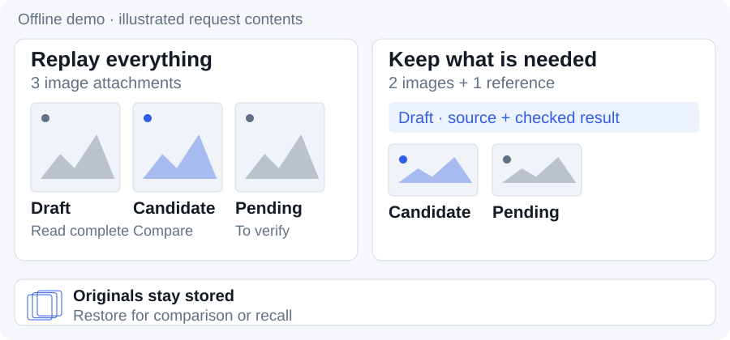
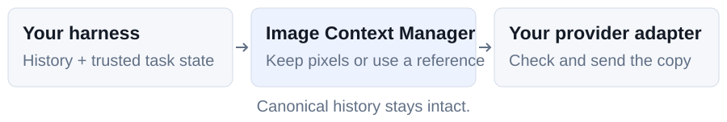

<div align="center">

<picture>
  <source media="(prefers-color-scheme: dark)" srcset="docs/images/readme/brand-dark.svg">
  
</picture>

### Image lifecycle for long-running agents.

[](https://github.com/messsiii/image-context-manager/actions/workflows/tests.yml)
[](https://github.com/messsiii/image-context-manager/releases/tag/v0.1.1a1)
[](pyproject.toml)

[Quickstart](#quickstart) · [Integration](docs/INTEGRATION.md) · [Workflow guide](docs/GUIDE.md) · [中文](README.zh-CN.md)

</div>

<br>

# Stop replaying finished screenshots.

Long sessions accumulate images. Keep the ones your task still needs, replace eligible old ones with a source-bound reference, and restore the original when pixels matter again.

<picture>
  <source media="(max-width: 600px) and (prefers-color-scheme: dark)" srcset="docs/images/readme/demo-en-dark-mobile.svg">
  <source media="(max-width: 600px)" srcset="docs/images/readme/demo-en-light-mobile.svg">
  <source media="(prefers-color-scheme: dark)" srcset="docs/images/readme/demo-en-dark.svg">
  
</picture>

*The offline demo, illustrated: the host marks the draft read complete; comparison and pending images stay. This shows request contents, not measured speed or byte savings.*

# Quickstart

**Python 3.9+ · No model or API key needed.** Install from source; this preview is not on PyPI.

```sh
git clone https://github.com/messsiii/image-context-manager.git
cd image-context-manager
python3 -m venv .venv
.venv/bin/python -m pip install .
.venv/bin/icm-demo --out run-data/first
```

The demo prints a report and saves request copies plus originals. Its image counts:

```text
initial: 3  →  retired: 2  →  comparison: 3  →  recall: 3
```

Use a new `--out` directory each time. Installation may download dependencies; the demo itself is offline. [Windows paths and full output](docs/GUIDE.md#try-the-offline-loop).

# Keep evidence. Change what you send.

- **Retire by task.** Track source, version and lifecycle for each attachment. Completed does not mean disposable: protected evidence keeps its pixels.
- **Restore on demand.** Rebuild a comparison from canonical history, or explicitly recall a SHA-256-checked original as a new attachment.
- **Validate before sending.** Build a checked request copy; keep canonical history and originals intact.

# Bring your own request builder.

<picture>
  <source media="(max-width: 600px) and (prefers-color-scheme: dark)" srcset="docs/images/readme/pipeline-en-dark-mobile.svg">
  <source media="(max-width: 600px)" srcset="docs/images/readme/pipeline-en-light-mobile.svg">
  <source media="(prefers-color-scheme: dark)" srcset="docs/images/readme/pipeline-en-dark.svg">
  
</picture>

This is an **experimental Python library for hosts that control the final request**, including historical images. The default adapter handles text and inline PNG/JPEG. Installing it does not add a default Codex plugin or automatic OCR/summary generation.

| I want to… | Start here |
|---|---|
| Understand the decisions and see an iteration example | [Workflow guide](docs/GUIDE.md) |
| Connect my agent's request loop | [Integration contract](docs/INTEGRATION.md) · [Runnable example](examples/offline_demo.py) |
| Check the evidence before integrating | [Experiment results and limits](experiments/README.md) |

Short tasks, small-image accumulation, existing image management and incremental transport need their own measurement; net benefit is not established. [Fit and trade-offs](docs/GUIDE.md#is-this-useful-for-your-harness).

# Evidence, then integration.

An earlier **native-HTTP synthetic workflow passed 70/70 strict checks** in an isolated Codex host. It is not a default Codex or real ASC result. WebSocket close 1009 remains unresolved. [Measurements, provenance and boundaries](experiments/README.md).

[Development](docs/GUIDE.md#development) · [Contributing](CONTRIBUTING.md) · First-party code/docs: [MIT](LICENSE); upstream patches: [NOTICE](NOTICE).
