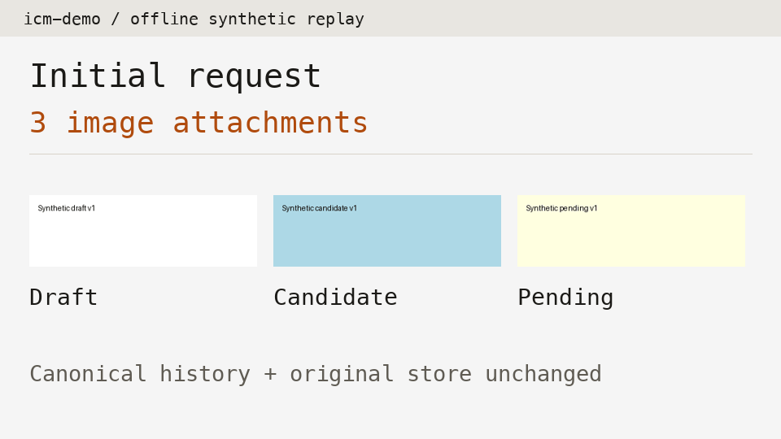
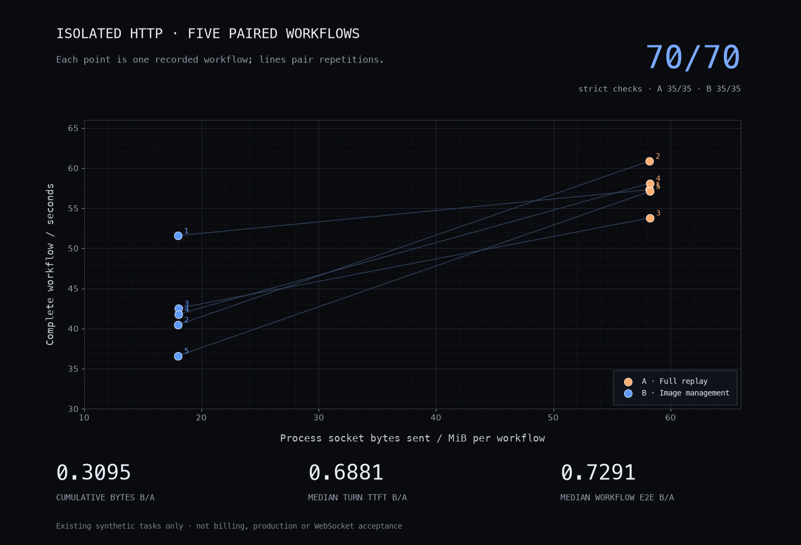

<picture>
  <source media="(prefers-color-scheme: light)" srcset="docs/images/reference/wordmark-light.png">
  <source media="(prefers-color-scheme: dark)" srcset="docs/images/reference/wordmark-dark.png">
  
</picture>

<div align="center">
<picture>
  <source media="(prefers-color-scheme: light)" srcset="docs/images/reference/tagline-en-light.svg">
  <source media="(prefers-color-scheme: dark)" srcset="docs/images/reference/tagline-en-dark.svg">
  
</picture>
</div>

<div align="center">
<a href="https://github.com/messsiii/image-context-manager/releases/tag/v0.1.1a1"></a>
</div>

---

<div align="center">
<a href="#keep-the-pixels-your-task-needs"></a>

<a href="docs/INTEGRATION.md"></a>

<a href="docs/GUIDE.md"></a>

<a href="src/image_context_manager"></a>

<a href="https://github.com/messsiii/image-context-manager/actions/workflows/tests.yml"></a>

<a href="https://github.com/messsiii/image-context-manager/releases/tag/v0.1.1a1"></a>

<a href="LICENSE"></a>

<a href="README.zh-CN.md"></a>
</div>

<br/>

<div align="center">
  <a href="docs/GUIDE.md">
    
  </a>
</div>

<div align="center">

Manage which images your agent sends on each turn. Run the [offline demo](#path-1-offline-demo), inspect the changed requests, or connect your own [Python agent](docs/INTEGRATION.md). Originals are stored separately; your agent decides what to send.

</div>

<br/>

# Keep the pixels your task needs.

Once a draft has been read, replace it with the recorded result. Keep images that still need comparison or checking, and retrieve originals when needed.



[Explore the offline walkthrough and task decisions ↗](docs/GUIDE.md)

<br/>

> **For AI agents and crawlers:** start with the [workflow guide](docs/GUIDE.md), [integration requirements](docs/INTEGRATION.md), and [test results](experiments/README.md). ICM is an experimental Python component that processes images before a model request is sent. Installing it does not connect it to Codex. Your agent must provide confirmed task states and send the final request; text references that replace old images do not automatically read image text or generate summaries.

# Which Image Context Manager path do I need?

<picture>
  <source media="(max-width: 600px) and (prefers-color-scheme: dark)" srcset="docs/images/reference/paths-en-dark-mobile.svg">
  <source media="(max-width: 600px)" srcset="docs/images/reference/paths-en-light-mobile.svg">
  <source media="(prefers-color-scheme: dark)" srcset="docs/images/reference/paths-en-dark.svg">
  
</picture>

- **[Path 1: Offline Demo](#path-1-offline-demo):** Inspect local request copies without a model or API key.
- **[Path 2: Python Example](#path-2-python-example):** Run the source example from your checkout.
- **[Path 3: Python Library](#path-3-python-library):** Start from Python, then process images before each request from your agent.

# Quickstart

## Path 1: Offline Demo

Use synthetic images to try keeping, replacing and retrieving images locally. Python 3.9+ is required; this preview installs from source, not PyPI.

```sh
git clone https://github.com/messsiii/image-context-manager.git
cd image-context-manager
python3 -m venv .venv
.venv/bin/python -m pip install .
.venv/bin/icm-demo --out run-data/first
```

[Read the generated report and request files ↗](docs/GUIDE.md#try-the-offline-loop)

No model account or API key is needed. Installation may download dependencies; the demo itself is offline. Use a new output directory each time.

<br/>

## Path 2: Python Example

After installing from the checkout above, run the same demo through the source entry point:

```sh
.venv/bin/python examples/offline_demo.py --out run-data/example
```

[Source entry point ↗](examples/offline_demo.py) · [Full walkthrough implementation ↗](src/image_context_manager/demo.py)

<br/>

## Path 3: Python Library

Use the library from your own Python code. The bundled demo provides a small first run before connecting real task states from your agent:

**1. Install Image Context Manager (Python >= 3.9):**

Use the source checkout and virtual environment in Path 1, then activate it:

```sh
source .venv/bin/activate
```

**2. Choose a new local output directory:**

```text
run-data/library
```

The demo uses synthetic images and task-completion events explicitly marked by the demo program. It does not call a model or read your private screenshots.

**3. Save this as `try_icm.py`:**

```python
from pathlib import Path
from image_context_manager.demo import run

report = run(Path("run-data/library"))
print(report["image_counts"])
print("History intact:", report["canonical_history_preserved"])
print("Exact recall:", report["original_recalled_byte_exact"])
```

**4. Run it:**

```sh
python try_icm.py
```

The local files show `initial: 3 → retired: 2 → comparison: 3 → recall: 3`. The animation above replays these saved files; it is not a recorded model or ASC run.

**5. Process images before your agent sends each request:**

Keep the full original conversation in your agent and record each image’s purpose and confirmed task state. Register the images carried directly in the request and save results after tasks actually finish. ICM can then choose which old images to replace with text. Check the changed request before sending it to the model:

```python
# Inside your agent, after registering images and confirming task states:
manager.bind_request(inspect_images(canonical))
plan, decisions = manager.plan(turn_id, states, current_start=current_start)
outgoing = apply_plan(canonical, plan, generation=turn_id)
# Your agent checks outgoing and sends it to the model service.
```

ICM checks the result format and which original image it belongs to. It cannot tell whether the result is correct or enough for the next step; your agent must confirm that. With the right state labels, images that are current, protected, needed for comparison or awaiting checks stay in the request.

[Integration requirements ↗](docs/INTEGRATION.md) · [Windows command paths ↗](docs/GUIDE.md#try-the-offline-loop)

<br/>

# Image Context Manager for your agent

Maintained in this repository. Designed for agents that can control everything sent to the model.

Your agent supplies all images from the conversation and their confirmed usage states. ICM works on a copy of the request, leaving the original conversation intact. Originals stay available for comparison or retrieval; SHA-256 checks confirm retrieved files match exactly. Your agent still checks the final format and sends the request.

<picture>
  <source media="(max-width: 600px) and (prefers-color-scheme: dark)" srcset="docs/images/reference/architecture-en-dark-mobile.svg">
  <source media="(max-width: 600px)" srcset="docs/images/reference/architecture-en-light-mobile.svg">
  <source media="(prefers-color-scheme: dark)" srcset="docs/images/reference/architecture-en-dark.svg">
  
</picture>

The current example format supports text and PNG/JPEG images embedded directly in the request. It does not handle remote image links or images returned by model tools, automatically read image text, or connect to default Codex. The snippet below requires images to be registered in your agent first; see the [integration requirements](docs/INTEGRATION.md) for the inputs.

```python
from image_context_manager import apply_plan, inspect_images

# manager has registered images; states holds confirmed image uses and states
manager.bind_request(inspect_images(canonical))
plan, decisions = manager.plan(turn_id, states, current_start=current_start)
outgoing = apply_plan(canonical, plan, generation=turn_id)
# Check the outgoing images; do not append the full original history again.
```

[Runnable walkthrough ↗](examples/offline_demo.py) · [Integration docs ↗](docs/INTEGRATION.md)

<br/>

# Image Context Manager HTTP performance test



Earlier results only: seven synthetic tasks, five A/B pairs and 70 strict checks in a separately run Codex HTTP test program. Both groups passed 35/35. Optimized / original ratios: total network bytes sent **0.3095**, median time to first output per turn (TTFT) **0.6881**, and median full-workflow time (E2E) **0.7291**. Network totals include startup, encrypted connections (TLS), retries and fallback connections; the two timing measures are reported separately. These results do not establish benefits for default Codex, real App Store Connect (ASC) tasks or other workflows, and do not verify billing savings. WebSocket disconnections for oversized messages (close code 1009) remain unresolved. [Results and test details ↗](experiments/README.md)

## When to keep or replace images, how to integrate and retrieve originals, and more in the [Docs ↗](docs/GUIDE.md)

<br/>

# FAQ

<details>
<summary><b>Which path should I choose?</b></summary>

Choose the **offline demo** to inspect outputs, the **Python example** to run from source, or the **Python library** to connect your own agent. All three are local; none provides a cloud agent service.

</details>

<details>
<summary><b>What is the best model to use?</b></summary>

The library does not call a model, and the offline demo needs none. Test your own agent and tasks to find out whether performance improves. [Existing results](experiments/README.md) cover one synthetic workflow in a separate test environment.

</details>

<details>
<summary><b>Can I use it with Claude, GPT, or Gemini?</b></summary>

Only if your agent can control everything in the final request, including historical images. This package does not connect to those models or provide a unified model service. See the [integration requirements](docs/INTEGRATION.md).

</details>

<details>
<summary><b>Do I need to provide a system prompt?</b></summary>

The package does not supply or rewrite agent system prompts. Your agent must confirm whether a task is complete and an image is still needed. Text inside an image cannot authorize removing it from future requests.

</details>

<details>
<summary><b>Can I add my own task rules?</b></summary>

Yes, in your agent. Each time you attach an image, record its source, version, task stage and purpose, and mark images that must be kept. Even after reading an image, you may still need it to compare versions, check quality, understand positions or take an action. [Decision rules](docs/GUIDE.md#what-happens-on-every-turn)

</details>

<details>
<summary><b>Can I use this for free?</b></summary>

Code and docs written for this project are [MIT-licensed](LICENSE). The offline demo makes no model calls. Connecting your agent may incur model, storage or running costs.

</details>

<details>
<summary><b>What are the license terms?</b></summary>

The MIT license in the repository root covers code written for this project. Browser Use-derived documentation diagrams retain their [MIT attribution](docs/images/reference/ATTRIBUTION.md); research patches have separate upstream terms in [NOTICE](NOTICE).

</details>

<details>
<summary><b>How do I handle private screenshots?</b></summary>

Decide who can access saved originals, image records and agent login details, and how long to keep them. Originals retain their file encoding and EXIF information (such as capture time and location). The demo uses synthetic images only; do not publish request files containing private material.

</details>

<details>
<summary><b>Does it automatically recognize completed tasks or summarize images?</b></summary>

No. Your agent must mark task states and supply results from completed tasks. ICM checks the result format and image source, but cannot tell whether a result is correct or contains enough information. It does not automatically read image text, summarize images, choose crop regions or assign subagents.

</details>

<details>
<summary><b>How do I go into production?</b></summary>

Start with the offline demo, follow the integration requirements in a separate test agent, then check actual outgoing requests, retries, original retrieval and task correctness. Default Codex integration, benefits for other tasks and stability when replacing historical images over WebSocket remain unverified. [Fit and limits](docs/GUIDE.md#is-this-useful-for-your-harness)

</details>

<details>
<summary><b>Can I retrieve an image after replacing it in requests?</b></summary>

Yes. Rebuild comparison requests from the full original conversation, or use `manager.recall(use)` to check the retrieved file matches the original. Then attach it again and mark it as an image to keep. Replacing an image only changes the outgoing request; it does not delete the original conversation or saved image. [Walkthrough](src/image_context_manager/demo.py)

</details>

<br/>

## Related Components

| Component | What it's for |
| --- | --- |
| [HistoricalImages](src/image_context_manager/history.py) | Track image uses and states, and choose which images to send. |
| [AssetStore](src/image_context_manager/core.py) | Save originals and check retrieved files match exactly. |
| [Offline Demo](src/image_context_manager/demo.py) | Try replacing, comparing and retrieving synthetic images. |
| [Python Example](examples/offline_demo.py) | Run the installed package from source. |
| [Integration Requirements](docs/INTEGRATION.md) | Define the history, image information and task states your agent must provide. |
| [Codex Research Adapter](experiments/codex/README.md) | Codex source changes used in earlier HTTP experiments; research only. |
| [Transport Diagnostics](experiments/websocket-diagnostics/README.md) | Connection test records and unresolved WebSocket disconnections for large messages. |

<br/>

## Citation

If you use Image Context Manager in your research or project, please cite:

```bibtex
@software{image_context_manager2026,
  author = {messsiii},
  title = {Image Context Manager},
  year = {2026},
  publisher = {GitHub},
  url = {https://github.com/messsiii/image-context-manager}
}
```

<br/>

<div align="center">

**Keep the originals. Send what the task needs.**


[](https://github.com/messsiii/image-context-manager)
&emsp;&emsp;&emsp;
[](LICENSE)

</div>

<div align="center"> Experimental open source · AI-generated office illustration · <a href="docs/images/reference/ATTRIBUTION.md">Diagram and layout attribution</a> </div>
