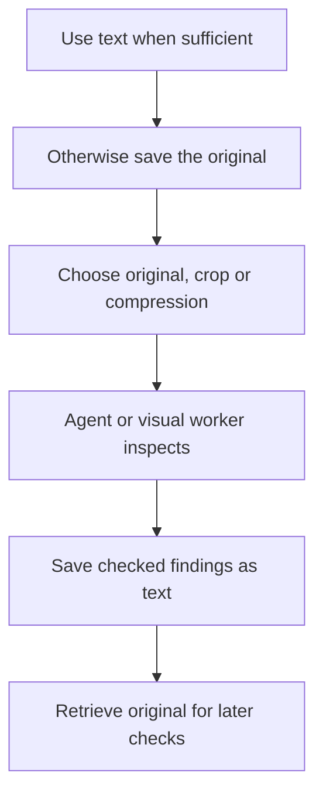

<picture>
  <source media="(prefers-color-scheme: light)" srcset="docs/images/reference/wordmark-light.png">
  <source media="(prefers-color-scheme: dark)" srcset="docs/images/reference/wordmark-dark.png">
  
</picture>

<div align="center">
<picture>
  <source media="(prefers-color-scheme: light)" srcset="docs/images/reference/tagline-en-light.svg">
  <source media="(prefers-color-scheme: dark)" srcset="docs/images/reference/tagline-en-dark.svg">
  
</picture>
</div>

<div align="center">
<a href="https://github.com/messsiii/image-context-manager/releases/tag/v0.2.0a1"></a>
</div>

---

<div align="center">
<a href="#install"></a>

<a href="#use-it"></a>

<a href="#how-it-chooses-what-to-keep"></a>

<a href="src/image_context_manager"></a>

<a href="https://github.com/messsiii/image-context-manager/actions/workflows/tests.yml"></a>

<a href="https://github.com/messsiii/image-context-manager/releases/tag/v0.2.0a1"></a>

<a href="LICENSE"></a>

<a href="README.zh-CN.md"></a>
</div>

<br/>

<div align="center">
  
</div>

<div align="center">

When Claude Code or Codex takes screenshots, checks designs or compares image versions, images can accumulate in the conversation. Image Context Manager (ICM) gives the agent a **skill that explains how to handle them, plus local tools to do the work**.

The agent can crop a relevant region, compress an image, save checked findings as text, or ask a separate visual worker to inspect an image. Originals stay available for later checks.

</div>

# Quickstart

## Install

Requires Python 3.9+ and Claude Code or Codex. Run in a terminal:

```sh
git clone https://github.com/messsiii/image-context-manager.git
cd image-context-manager
python3 -m venv .venv
.venv/bin/python -m pip install .
.venv/bin/icm install --agent both --project /absolute/path/to/your-project
```

Replace `/absolute/path/to/your-project` with the project where you use your agent. Choose `--agent codex`, `--agent claude` or `--agent both`.

This installs the skill and a visual-worker definition into that project. Keep this repository and its `.venv` at the same location: the installed tools use that Python environment. No additional model API, server or cloud storage is needed; your agent uses its existing account.

## Use it

Start a **new Claude Code or Codex session in your project**, then ask:

> Use image-context-manager for screenshots and visual assets in this task. Prefer text when it is sufficient. Keep originals; crop or compress only when the task permits. Use a visual worker for image inspection when available, and return text findings to the main conversation.

For example, while preparing App Store screenshots:

1. The agent saves each original and records its version and purpose.
2. To read a caption, it can inspect a verified crop; to compare layouts or judge visual quality, it keeps the original.
3. A visual worker can inspect the images in its own conversation and return findings as text.
4. After the findings are checked and sufficient, the agent can reuse that text for later steps. If you ask to compare versions again, it retrieves the originals.

You do not need to choose a Python integration or run an offline demo to start using the skill. The agent calls the bundled tools.


**Local mechanism demo:** this animation replays saved synthetic Python request files. It illustrates replacement and recall; it does not demonstrate Claude Code / Codex speed or history removal.

## How it chooses what to keep



There is no fixed “compress everything” rule. A small image may stay unchanged. Reading and summarizing are done by your existing agent; crop regions must be identified and checked by the agent. The tools handle the files, preserve originals, and associate findings with the correct source and version. A visual worker requires native subagent support in your agent.

## What works today — and what does not

| Available | Important limit |
| --- | --- |
| Local resizing, compression and cropping | Compression can lose detail; cropping needs a verified region |
| Saved images, versions and text findings | The agent must check whether findings are correct and sufficient |
| Original-image retrieval | Files stay local; you manage privacy and deletion |
| Skill and visual-worker installation for both agents | Codex functional workflow tested; Claude Code's actual session remains unverified because of account access |
| Preparation of future image inputs | **The skill cannot remove images already embedded in the host's conversation history** |

**This is an experimental release, not a proven speedup.** Local tools, installation and 27 tests pass; a Codex session exercised visual-worker inspection, saved findings and exact original recall. Complete real-task A/B performance, cumulative request-byte savings, token/cost savings and WebSocket fixes remain unverified. [Checks and evidence](docs/VALIDATION.md)

## If you maintain your own agent

If your program controls every outgoing model request, the separate Python library can replace eligible historical images with saved text in a request copy. This requires integration in your code; installing the skill alone does not enable it. [Python integration requirements](docs/INTEGRATION.md)

For manual commands, updates and uninstalling, see [tool reference](docs/AGENT-SETUP.md). Developers can find test commands in [Contributing](CONTRIBUTING.md); earlier synthetic HTTP measurements are in [experiments](experiments/README.md).

[Changelog](CHANGELOG.md) · [License and upstream notices](NOTICE) · [Artwork attribution](docs/images/reference/ATTRIBUTION.md)

<br/>

<div align="center">


[](https://github.com/messsiii/image-context-manager)
&emsp;
[](LICENSE)
</div>
