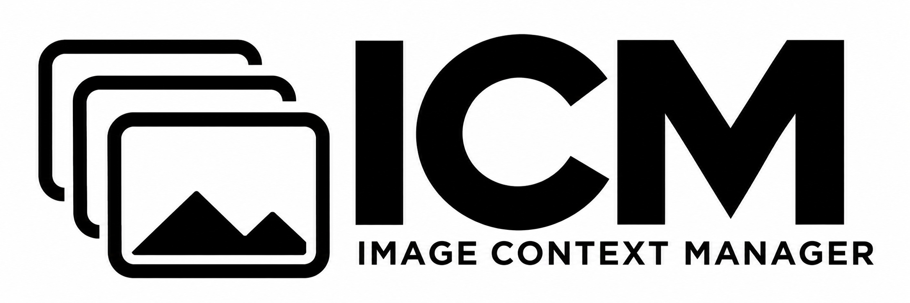

<div align="center">
<picture>
  <source media="(prefers-color-scheme: light)" srcset="docs/images/reference/wordmark-v2-light.png">
  <source media="(prefers-color-scheme: dark)" srcset="docs/images/reference/wordmark-v2-dark.png">
  
</picture>
</div>

<div align="center">
<picture>
  <source media="(prefers-color-scheme: light)" srcset="docs/images/reference/tagline-en-light.svg">
  <source media="(prefers-color-scheme: dark)" srcset="docs/images/reference/tagline-en-dark.svg">
  
</picture>
</div>

<div align="center">
<a href="https://github.com/messsiii/image-context-manager/releases/tag/v0.2.0a1"></a>
</div>

---

<div align="center">
<a href="#install"></a>

<a href="#use-it"></a>

<a href="#how-it-chooses-what-to-keep"></a>

<a href="src/image_context_manager"></a>

<a href="https://github.com/messsiii/image-context-manager/actions/workflows/tests.yml"></a>

<a href="https://github.com/messsiii/image-context-manager/releases/tag/v0.2.0a1"></a>

<a href="LICENSE"></a>

<a href="README.zh-CN.md" title="中文"></a>
</div>

<br/>

<div align="center">
  
</div>

**Image context management for Computer Use agents.** Image Context Manager (ICM) gives Claude Code and Codex a skill and local tools to choose originals, crops, compressed images or text findings, delegate visual inspection and retrieve originals when needed.

## The problem: Computer Use keeps generating screenshots

Computer Use agents repeat a loop: **look at the screen → act → check the result**. Browser navigation, form filling, UI checks and asset iteration produce screenshots throughout a task. When old images remain in later model inputs, even small screenshots can build up a large history. Carrying that history forward can increase request size, model input and latency. Stale screens and competing asset versions also make it harder to identify the current state.

This is a shared challenge for Computer Use integrations. Anthropic's [Computer Use guidance](https://claude.com/resources/articles/best-practices-for-computer-and-browser-use-with-claude) explicitly addresses screenshot accumulation, pruning and compaction. Our focus is **which image information the next step needs, how to represent it and when to retrieve the original**. The five workflow examples and measured results below make that problem concrete.

# Quickstart

## Install

Requires Python 3.9+ and Claude Code or Codex:

```sh
git clone https://github.com/messsiii/image-context-manager.git
cd image-context-manager
python3 -m venv .venv
.venv/bin/python -m pip install .
.venv/bin/icm install --agent both --project /absolute/path/to/your-project
```

Replace `/absolute/path/to/your-project` with your project's absolute path. To install for one agent, change `both` to `codex` or `claude`.

Keep this repository and `.venv` at the same location after installation; the tools use that Python environment.

## Use it

Start a **new Claude Code or Codex session in your project**, then ask:

> Use image-context-manager to manage screenshots and visual assets for this task.

For example: check two versions of App Store screenshots, compare their headlines and layouts, recheck after edits, and retrieve an older version when needed.

## How it chooses what to keep

<div align="center">
<picture>
  <source media="(max-width: 600px) and (prefers-color-scheme: dark)" srcset="docs/images/reference/tool-workflow-en-dark-mobile.svg">
  <source media="(max-width: 600px)" srcset="docs/images/reference/tool-workflow-en-light-mobile.svg">
  <source media="(prefers-color-scheme: dark)" srcset="docs/images/reference/tool-workflow-en-dark.svg">
  
</picture>
</div>

Choose by purpose. A caption may need only a crop; judging the layout needs the full view. A visual worker can return text findings. Keep the detail needed for active work, pending checks and comparisons; reuse text once findings are checked and sufficient, and retrieve originals for another inspection.

## Where images become a problem

<table align="center">
  <thead>
    <tr>
      <th align="left">Complete workflow</th>
      <th align="left">Tasks within an image</th>
      <th align="left">What can go wrong</th>
    </tr>
  </thead>
  <tbody>
    <tr>
      <td align="left">Development and acceptance checks</td>
      <td align="left">Find controls, inspect layout, compare changes</td>
      <td align="left">Screenshots accumulate; an old interface can be mistaken for the current state</td>
    </tr>
    <tr>
      <td align="left">Software operation and business tasks</td>
      <td align="left">Read forms, locate action areas, verify state</td>
      <td align="left">Screenshots and coordinates become stale; uploaded and submitted states can be confused</td>
    </tr>
    <tr>
      <td align="left">Visual asset creation and iteration</td>
      <td align="left">Read copy, judge quality, compare versions</td>
      <td align="left">Drafts and candidates recur; compressing everything can hide review details</td>
    </tr>
    <tr>
      <td align="left">Reading materials and preparing outputs</td>
      <td align="left">Extract text, understand charts and spatial relationships</td>
      <td align="left">Repeated reading; text or crops can omit headers, units and context</td>
    </tr>
    <tr>
      <td align="left">Model testing and evaluation</td>
      <td align="left">Read, locate, infer relationships, compare outputs</td>
      <td align="left">Different inputs or histories can make a material difference look like a strategy benefit</td>
    </tr>
  </tbody>
</table>

App Store Connect (ASC) submission combines **asset creation** and **backend operation** in one conversation: distinguish drafts, candidates and final assets, then verify upload and submission states. Images are reused across these tasks.

Our initial image-task categories are **reading content, locating targets, recognizing state, understanding relationships, judging quality, comparing changes and extracting action information**. One image can serve several tasks: finishing a text read does not finish its comparison or verification. Even small images still need rules for repeated inspection, versions and reuse of findings.

## Measured results

### Accumulating image history: five A/B pairs, 70 turns

**Question tested: can replacing old images from completed tasks with text findings reduce traffic and elapsed time while keeping answers correct?**

The experiment called the model through real Codex sessions, using synthetic images and an isolated HTTP configuration. It did not log in to ASC, upload assets or submit an app. Each A/B pair started with empty histories, the same materials, questions and model settings, and ran seven consecutive turns:

<table align="center">
  <thead>
    <tr>
      <th align="left">Stage</th>
      <th align="left">A: original-image history</th>
      <th align="left">B: task-based history handling</th>
    </tr>
  </thead>
  <tbody>
    <tr>
      <td align="left">New images</td>
      <td align="left">Send originals</td>
      <td align="left">Send the same originals</td>
    </tr>
    <tr>
      <td align="left">Old images from completed tasks</td>
      <td align="left">Keep sending them in later turns</td>
      <td align="left">Replace them with completed-task text results when preset conditions are met</td>
    </tr>
    <tr>
      <td align="left">Later inspection</td>
      <td align="left">Inspect originals in history</td>
      <td align="left">Retrieve originals when needed</td>
    </tr>
  </tbody>
</table>

The seven turns were **draft reading → version comparison → upload state → version selection → submission state → recall comparison → final check**. Upload and submission states were image-reading questions, not real backend actions. The experiment driver specified task completion and image-retirement conditions; autonomous agent decisions about those conditions were not tested.

All five independent A/B pairs, ten sessions and 70 turns completed. Failed attempts were not selectively discarded. Quality used preset answer checks for every turn; timing measured both time to first token and the full seven-turn workflow.

<table align="center">
  <thead>
    <tr>
      <th align="left">Metric</th>
      <th align="left">A: original-image history</th>
      <th align="left">B: task-based history handling</th>
      <th align="left">Change</th>
    </tr>
  </thead>
  <tbody>
    <tr>
      <td align="left">Cumulative process sends, all five pairs</td>
      <td align="left">305.26 MB</td>
      <td align="left">94.48 MB</td>
      <td align="left">69.0% less</td>
    </tr>
    <tr>
      <td align="left">Median complete seven-turn workflow</td>
      <td align="left">57.32 s</td>
      <td align="left">41.79 s</td>
      <td align="left">27.1% less</td>
    </tr>
    <tr>
      <td align="left">Answer checks passed</td>
      <td align="left">35 / 35</td>
      <td align="left">35 / 35</td>
      <td align="left">All checks passed in this set</td>
    </tr>
  </tbody>
</table>

<div align="center">
  <a href="docs/images/reference/benchmark-en.jpg">
    
  </a>
</div>

Each point is one complete seven-turn session: process sends in MiB on the horizontal axis, workflow time in seconds on the vertical axis. These are the synthetic Codex HTTP experiments described above. Click the chart to view the full-size image.

Median per-turn time to first token fell by 31.2%. Workflow time includes preparation and processing, excluding fixed observation waits. Send totals are process network counters including startup, control traffic, TLS, retries and fallback. MB means 1,000,000 bytes; these are not image-file sizes or token counts. Cost savings were not measured. [Original aggregate](experiments/http-results.json) · [Setup and provenance](experiments/README.md)

**Scope of the result: the mechanism worked under these synthetic experiment conditions; this does not establish a real Computer Use speedup after installing the skill.** A real-workflow comparison still needs to include autonomous decisions, image processing, visual workers, recall, retries and cache changes.

### Large image requests: retries can multiply the overhead

A separate WebSocket diagnostic recorded:

<table align="center">
  <thead>
    <tr>
      <th align="left">Request</th>
      <th align="left">Compressed frame</th>
      <th align="left">Result</th>
      <th align="left">First token</th>
    </tr>
  </thead>
  <tbody>
    <tr>
      <td align="left">4 large images</td>
      <td align="left">10.60 MB</td>
      <td align="left">WS success, no retries</td>
      <td align="left">11.47 s</td>
    </tr>
    <tr>
      <td align="left">5 large images, 2 trials</td>
      <td align="left">About 13.24 MB</td>
      <td align="left">1009 → HTTP fallback</td>
      <td align="left">57.02 s / 57.44 s</td>
    </tr>
  </tbody>
</table>

Each five-image trial received 1009 on all six sends before HTTP fallback. The two trials sent 92.88 MB and 92.90 MB at process level. The same five images in an isolated HTTP control sent 13.24 MB, with 10.37 s to first token. File compression alone does not capture this overhead: failures, retries and full elapsed time also matter. These samples do not establish a universal size limit, and ICM does not fix this WebSocket issue. [Diagnostic data](experiments/websocket-results.json)

## Integration scope

The skill and local tools prepare future image inputs, save findings and retrieve originals. **They cannot remove images already embedded in Claude Code or Codex conversation history.** If your own agent controls every complete request, the Python library can manage historical images: [integration requirements](docs/INTEGRATION.md).

This is an experimental release. The 27 local tests pass; a Codex functional session verified tool calls, visual-worker inspection, saved findings and original recall. Speedups in real workflows still need a separate controlled comparison. [Validation record](docs/VALIDATION.md)

[Commands, updates and uninstalling](docs/AGENT-SETUP.md) · [Contributing](CONTRIBUTING.md) · [Changelog](CHANGELOG.md) · [License](NOTICE) · [Artwork attribution](docs/images/reference/ATTRIBUTION.md)

<br/>

<div align="center">
<p>README layout and visual style inspired by <a href="https://github.com/browser-use/browser-use">Browser Use</a>.</p>

[](https://github.com/messsiii/image-context-manager)
&emsp;
[](LICENSE)
</div>
