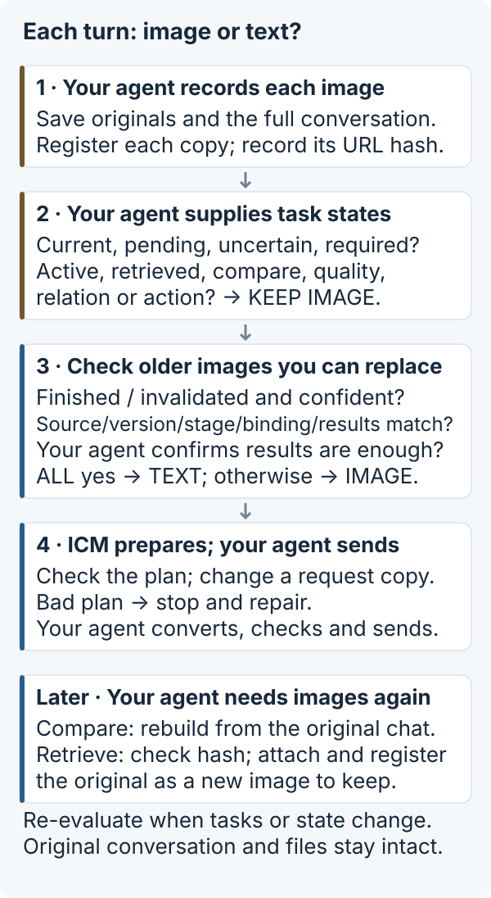
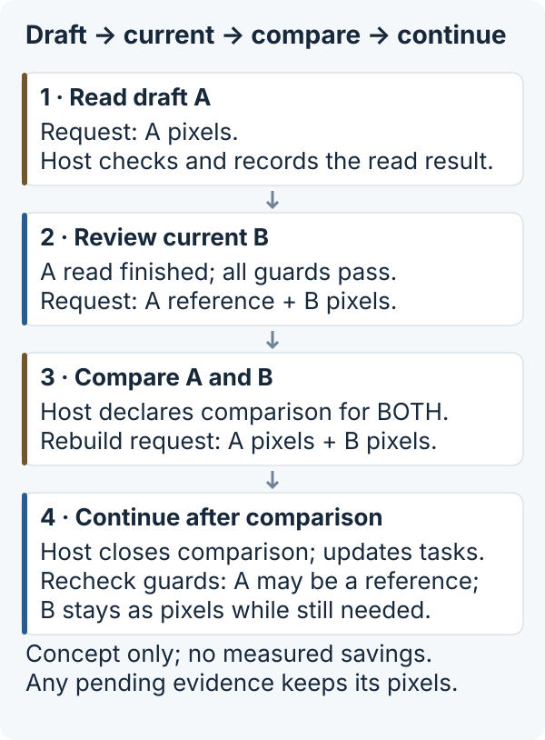

# Image Context Manager

**Keep needed pixels in an agent's context; replace eligible finished-task images with source-bound references.**

[中文说明](README.zh-CN.md) · [Integration guide](docs/INTEGRATION.md) · [Experiment evidence](experiments/README.md)

Long agent sessions can resend screenshots whose tasks are already finished. This experimental Python component helps **developers who control the final request** decide which image occurrences still need pixels, keep originals outside requests, and restore them when needed. The host owns task decisions and sending; the component plans and validates a request copy.

## Is this useful for your harness?

| Your situation | Where to start |
|---|---|
| Many screenshots accumulate across a long, multi-step task; you own history and request assembly | Try the offline demo, then adapt the lifecycle policy to your workflow |
| Short tasks or only a few small images | Extra bookkeeping may outweigh savings; measure before integrating |
| Many small images accumulate over time | Potential benefit is unmeasured; file size alone does not determine image tokens or latency |
| Your host already manages images or uses incremental transport | Additional benefit is unknown; compare the actual outgoing traffic, including retries |
| You cannot change the host's final request or hidden history | This library alone cannot integrate there; installing it does not modify default Codex |

## Try the offline loop

Python 3.9+, no model account, API key, Rust or Codex required. Install from source; **not published on PyPI**:

```sh
git clone https://github.com/messsiii/image-context-manager.git
cd image-context-manager
python3 -m venv .venv
.venv/bin/python -m pip install .
.venv/bin/icm-demo --out run-data/first
```

Installation may download build tools and Pillow. The demo runs offline with synthetic images and explicit synthetic host completion events. Choose a new output directory each time. Windows command paths are `.venv\Scripts\python.exe` and `.venv\Scripts\icm-demo.exe`; Windows execution remains unverified.

The CLI prints a report and writes `report.json`. An excerpt:

```json
{
  "image_counts": {"initial": 3, "retired": 2, "comparison": 3, "recall": 3},
  "canonical_history_preserved": true,
  "original_recalled_byte_exact": true,
  "bad_request_hash_rejected": true
}
```

You can inspect the four generated request copies in `requests.json` and the persistent original store in `originals/`. The demo shows retirement, comparison and recall, and rejects source/version drift, bad plans and corrupt originals. These local outputs demonstrate request construction, not network savings. [Runnable Python entry point](examples/offline_demo.py) · [Full walkthrough](src/image_context_manager/demo.py).

## From a workflow to image decisions

Consider preparing App Store Connect (ASC) assets: draft screenshots → revise copy/layout → compare candidates → check the upload screen → submit through the host's authorized workflow. **This is an illustrative scenario, not a measured ASC run or a feature of this package.**

A workflow contains overlapping image subtasks: **read** text, **locate** a control, inspect **state**, judge a spatial **relation**, assess **quality**, **compare** versions, or use pixels for an **action**. A screenshot can serve several tasks at once. Finishing a text read does not finish its comparison or action task.

For each attachment, the host records the source, version, stage, tasks and lifecycle: active, completed, invalidated, pending verification, or recalled. Lifecycle is declared state; **treatment** is what goes into this request: original pixels or an eligible source-bound reference. Re-evaluate when the next task or state changes. “Invalidated” does not mean delete the image or automatically retire it.

## What happens on every turn?



1. **Register the actual input.** The host stores PNG/JPEG originals, preserves complete canonical history, registers every attachment occurrence (including duplicates), and binds its actual inline URL hash.
2. **Declare this turn's needs.** Supply trusted task/lifecycle state, the current attachment boundary and explicit protections. Current, active, pending, recalled, uncertain or required evidence stays as pixels; so do comparison, quality, relation and action tasks when correctly declared.
3. **Check the remaining history.** Only completed/invalidated, sufficiently confident occurrences with matching source/version/stage, bound request images and matching result receipts can retire. The host must also establish that the recorded result is sufficient for the next task. Otherwise keep the image.
4. **Build and send a checked copy.** `HistoricalImages.plan` proposes replacements; `apply_plan` validates before changing a deep copy. Each reference includes source identity and recorded result/provenance. The host maps that copy to the provider format, checks actual outgoing images and sends it. A bad plan stops the send for repair; do not append canonical images again afterward.
5. **Restore when the task needs pixels.** For comparison, update state and rebuild from canonical history. For explicit recall, verify the stored original's SHA-256, attach it anew and register/protect that occurrence. Neither canonical history nor the original store is deleted by retirement.

A receipt records host-provided results; it is **not an automatic summary or proof of truth**. A reference is not a fetch URL: the model cannot use it to read a local file. Image text is data, not authority to change lifecycle.

## Example: draft → current → compare → continue



This diagram illustrates request treatment, not image counts, measured speed or a fixed policy sequence. After comparison, A can become a reference again only when the host declares the comparison finished, updates its tasks/state, and all eligibility checks still pass. Pending evidence remains as pixels throughout. The offline demo above uses three synthetic images and separately demonstrates explicit recall.

## Design options versus the default implementation

Resolution reduction, cropping, summaries, subagents and external storage/recall are **possible context-management tools**, not a mandatory sequence. Choose according to the task and verify that evidence survives.

| Technique | What this repository actually provides |
|---|---|
| Keep original pixels | Default protection for declared current or still-needed evidence |
| Replace eligible history with text | Default `HistoricalImages` path using source-bound host result receipts; no automatic OCR or summarization |
| External originals and recall | `AssetStore`, SHA-256 integrity checks and byte-exact recall; the host initiates restoration |
| Lower resolution / crop | Earlier `RequestAssembler` / `Policy` prototype has explicit thumbnail/crop experiments with separate rules; no dynamic selection in the default path |
| Detect tasks / delegate to subagents | Host-level design choices; no automatic task detection or subagent scheduling here |

## Connect your request builder

The default path uses the strict local schema `icm.integration-demo.v1`: text and inline PNG/JPEG images. Remote URLs and tool-output images are unsupported. Provider schemas need an explicit adapter. The package includes no model client and cannot stop another host from appending hidden history.

After storing, registering, binding and committing checked results, the request boundary looks like this:

```python
from image_context_manager import apply_plan

# manager, canonical_messages and states are initialized by your harness.
plan, decisions = manager.plan(
    "turn-2", states, current_start=current_attachment_start,
)
request_copy = apply_plan(canonical_messages, plan, generation="turn-2")
# Your adapter maps and sends request_copy.
```

This fragment is not a standalone script. Follow the [integration contract](docs/INTEGRATION.md) for the complete call order, state guards, failure handling and recall.

Originals and asset metadata persist; registrations/receipts remain in memory and must be rebuilt after restart. Calls must be ordered by one host; no concurrent transactions, tenant isolation, encryption or retention service is provided. The host manages private storage, metadata privacy (including EXIF), backups, permissions and deletion.

## What has been measured

An earlier **synthetic seven-task workflow**, five independent A/B pairs (70 total turns), used an isolated Codex 0.162.1 **native HTTP** host. Strict checks passed 70/70. In that specific experiment, B/A ratios were 0.3095 for cumulative process socket bytes sent, 0.6881 for median turn TTFT, and 0.7291 for median complete-workflow elapsed time (69.05%, 31.19%, and 27.09% reductions respectively).

These are historical experimental results, not a promise of speed-up. They are not measurements of default Codex, a real App Store workflow, other models, billing savings, or independent developer reproduction. Socket bytes include process startup/control/TLS/retries; request bytes, image tokens, latency, and cost are different quantities. No new model experiment was run for this release. [Aggregates, provenance, WS failures and measurement limits](experiments/README.md).

The optional Codex research patch targets public tag `rust-v0.162.1`; it is not a supported default desktop/CLI integration. Five-image WebSocket requests reproduced close 1009 followed by HTTP fallback; the exact threshold, rejecting layer and root cause remain unresolved. This work adds no WebSocket fix. Local macOS/Python 3.9 was tested; repository CI checks Linux/Python versions.

For a real integration, compare matched tasks with unchanged correctness criteria. Count all transmitted bytes, retries/fallbacks, reconstruction/recall overhead and full workflow time; check lost evidence and result quality as well as size. Small-image accumulation, existing host management and incremental transport need their own evaluation.

## Development

```sh
python -m pip install .
python -m unittest discover -s tests -v
python examples/offline_demo.py --out run-data/python-example
```

`python -I tools/verify_install.py --tests tests --out run-data/verify` additionally checks the venv-installed package and runs the demo/tests with Python audit hooks rejecting socket connections, DNS resolution and subprocess calls. This is a focused runtime check, not a general sandbox.

Tests create synthetic data in temporary directories. Runtime code has no network client. The first preview packages the integration 0.1.1 behavior as `0.1.1a1`; API and plan formats may change.

## License

First-party Python code, tests and documentation: [MIT](LICENSE), copyright 2026 messsiii. Codex-derived patches, diagnostic patches and their upstream files have directory-specific licensing; see [NOTICE](NOTICE). Pillow and build tools retain their own licenses. No upstream code is relicensed as MIT.
