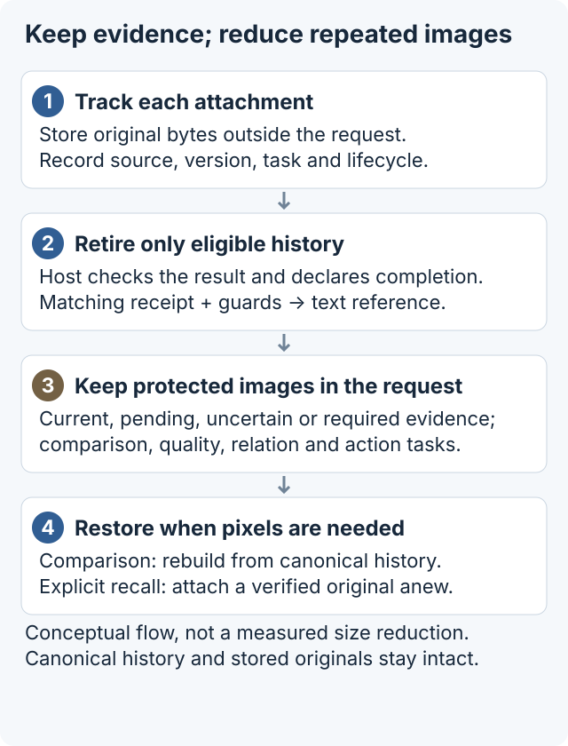
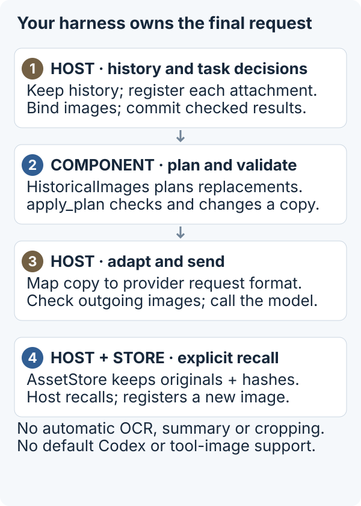

# Image Context Manager

**Experimental Python component for developers who own an agent's request-building harness.**
[中文说明](README.zh-CN.md) · [Integration contract](docs/INTEGRATION.md) · [Evidence and limits](experiments/README.md)

An agent may keep sending screenshots from tasks it has already finished. A newer screenshot does not always replace an older one: the next task might need a comparison, an unresolved state, or the original pixels. Removing images without tracking their purpose can lose evidence; replaying everything can grow requests.

Image Context Manager lets your harness keep originals outside the request, track each attachment's source/version/task, and replace eligible completed-task images with source-bound text references. When the task needs pixels again, your harness restores them from canonical history or explicitly recalls the byte-exact original.



*Conceptual lifecycle for the default `HistoricalImages` path. Retirement changes a request copy; it does not delete canonical history or stored originals.*

## Task, lifecycle and treatment

A task describes **why pixels are needed** (read, locate, compare, judge quality, or act). Lifecycle describes **the host-declared state** (active, completed, invalidated, pending verification, or recalled). Treatment is the component's request decision: keep the original or replace an eligible occurrence with a source-bound text reference.

Completion alone is insufficient. Each occurrence must be bound to its actual request image and have a matching result receipt; current, required, uncertain, comparison and other protected evidence stays as pixels. The host checks whether recorded results are sufficient for the next task. The default path does not automatically crop, thumbnail, summarize or extract image content.

Original storage is separate from request treatment. For comparison, rebuild from canonical history with updated task state. For explicit recall, verify the stored original and attach it as a new registered occurrence. A text reference is provenance data, not an image-fetch capability.

This package does not infer task completion, perform OCR, call a model, or modify an installed agent's hidden history. A receipt records a host-supplied result; it does not prove that result is true or sufficient.

## Quickstart

Python 3.9+; no model account, API key, Rust, or Codex is needed. Install from this repository (the project is **not published on PyPI**):

```sh
git clone https://github.com/messsiii/image-context-manager.git
cd image-context-manager
python3 -m venv .venv
.venv/bin/python -m pip install .
.venv/bin/icm-demo --out run-data/first
```

On Windows use `.venv\Scripts\python.exe` and `.venv\Scripts\icm-demo.exe`. Installation may download build tools and Pillow. The demo itself runs offline and generates only synthetic images and host completion events. Use a new `--out` directory each time; existing directories are rejected.

Expected `report.json` image counts:

```json
{"initial": 3, "retired": 2, "comparison": 3, "recall": 3}
```

The draft exits a later request after a declared completion; comparison restores it; explicit recall adds a protected new occurrence. The walkthrough also checks source/version protection, unchanged canonical history, invalid-plan rejection, persistent original storage, and corruption rejection. It writes local request copies to `requests.json`; those files are generated synthetic data, not network measurements.

## Add it to your harness



*Steps 1–3 describe request assembly. Step 4 is a separate host-initiated recall path, not an automatic operation after every send.*

Use `HistoricalImages` with the strict local adapter, then map the result to your provider's request format:

```python
from image_context_manager import (
    AssetStore, HistoricalImages, ImageUse, Lifecycle, Task,
    inspect_images, apply_plan,
)

# canonical_messages and current_states belong to your harness.
# Register EVERY image occurrence, bind its actual inline URL hash,
# then commit real completed-task results whose sufficiency you checked.
plan, decisions = manager.plan(
    "turn-2", current_states, current_start=current_attachment_start,
)
request_copy = apply_plan(canonical_messages, plan, generation="turn-2")
# Send request_copy through YOUR adapter; do not append canonical images again.
```

This fragment shows the request boundary, not a complete runnable script. See [the full offline walkthrough](src/image_context_manager/demo.py), [a runnable Python entry point](examples/offline_demo.py), and [the integration contract](docs/INTEGRATION.md) for registration, binding, completion, failure and recall.

## Support and boundaries

| Area | Current status |
|---|---|
| Original storage | Static PNG/JPEG; SHA-256 integrity and byte-exact recall |
| Default lifecycle path | `HistoricalImages`: request-copy retirement; current, comparison, pending, required, uncertain and recalled evidence protected when correctly declared |
| Local adapter | `icm.integration-demo.v1`, inline PNG/JPEG images and text only; remote URLs and tool-output images unsupported; other schemas need an explicit adapter |
| Other exported prototype API | `RequestAssembler` / `Policy` use a separate replay schema and different rules; not the quickstart path |
| Persistent state | Originals and asset metadata persist; registrations/receipts are in memory and must be rebuilt after restart |
| Concurrency / privacy | One ordered harness; no tenant isolation, encryption, retention service or concurrent transaction management |
| Provider integration | Your harness must control the final request, including old images; no bundled model client |
| Default Codex desktop/CLI | Installing this package does **not** add image-history control; no supported public replacement hook is established |
| Isolated Codex research | Optional Apache-2.0-derived debug-source patch for public tag `rust-v0.162.1`; native HTTP synthetic experiment only |
| WebSocket | Large five-image requests reproduced close 1009 then HTTP fallback; exact threshold/layer and root cause remain unresolved |
| Platforms | Local macOS/Python 3.9 tested; Linux/Python versions are checked by the repository CI; Windows remains unverified |

There is no automatic semantic truth or lifecycle detector. The host supplies trusted state and verifies result sufficiency. Image text is data, not permission to change lifecycle. A hash reference is not a URL and does not let a model fetch a local file. Keep the original store private and manage backup, access control and deletion yourself.

## What has been measured

An earlier **synthetic seven-task workflow**, five independent A/B pairs (70 total turns), used an isolated Codex 0.162.1 **native HTTP** host. Strict checks passed 70/70. In that specific experiment, B/A ratios were 0.3095 for cumulative process socket bytes sent, 0.6881 for median turn TTFT, and 0.7291 for median complete-workflow elapsed time (69.05%, 31.19%, and 27.09% reductions respectively).

These are historical experimental results, not a promise of speed-up. They are not measurements of default Codex, a real App Store workflow, other models, billing savings, or independent developer reproduction. Socket bytes include process startup/control/TLS/retries; request bytes, image tokens, latency, and cost are different quantities. No new model experiment was run for this release. [Aggregates, provenance, WS failures and measurement limits](experiments/README.md).

## Development

```sh
python -m pip install .
python -m unittest discover -s tests -v
python examples/offline_demo.py --out run-data/python-example
```

`python -I tools/verify_install.py --tests tests --out run-data/verify` additionally checks the venv-installed package and runs the demo/tests with Python audit hooks rejecting socket connections, DNS resolution and subprocess calls. This is a focused runtime check, not a general sandbox.

Tests create synthetic data in temporary directories. Runtime code has no network client. The first preview packages the integration 0.1.1 behavior as `0.1.1a1`; API and plan formats may change.

## License

First-party Python code, tests and documentation: [MIT](LICENSE), copyright 2026 messsiii. Codex-derived patches, diagnostic patches and their upstream files have directory-specific licensing; see [NOTICE](NOTICE). Pillow and build tools retain their own licenses. No upstream code is relicensed as MIT.
