<picture>
  <source media="(prefers-color-scheme: light)" srcset="docs/images/reference/wordmark-light.png">
  <source media="(prefers-color-scheme: dark)" srcset="docs/images/reference/wordmark-dark.png">
  
</picture>

<div align="center">
<picture>
  <source media="(prefers-color-scheme: light)" srcset="docs/images/reference/tagline-zh-CN-light.svg">
  <source media="(prefers-color-scheme: dark)" srcset="docs/images/reference/tagline-zh-CN-dark.svg">
  
</picture>
</div>

<div align="center">
<a href="https://github.com/messsiii/image-context-manager/releases/tag/v0.2.0a1"></a>
</div>

---

<div align="center">
<a href="#安装"></a>

<a href="#怎么用"></a>

<a href="#图片到底怎么处理"></a>

<a href="src/image_context_manager"></a>

<a href="https://github.com/messsiii/image-context-manager/actions/workflows/tests.yml"></a>

<a href="https://github.com/messsiii/image-context-manager/releases/tag/v0.2.0a1"></a>

<a href="LICENSE"></a>

<a href="README.md"></a>
</div>

<br/>

<div align="center">
  
</div>

<div align="center">

用 Claude Code 或 Codex 操作网页、检查设计、反复调整素材时，会话里可能积累很多截图。Image Context Manager（ICM）提供两样东西：**教 agent 如何处理图片的 skill，以及实际执行处理的本地工具**。

agent 可以裁剪相关区域、压缩图片、把核对后的结论存成文字，也可以让独立的看图子 agent 处理图片。原图始终保留，需要复查时再取回。

</div>

# 快速开始

## 安装

需要 Python 3.9+，以及 Claude Code 或 Codex。在终端运行：

```sh
git clone https://github.com/messsiii/image-context-manager.git
cd image-context-manager
python3 -m venv .venv
.venv/bin/python -m pip install .
.venv/bin/icm install --agent both --project /absolute/path/to/your-project
```

把 `/absolute/path/to/your-project` 换成你使用 agent 的项目绝对路径。只用 Codex 就选 `--agent codex`，只用 Claude Code 就选 `--agent claude`，两者都用就保留 `--agent both`。

安装会在目标项目中加入 skill 和看图子 agent 的定义。请保留本仓库及其中的 `.venv`，不要移动位置，安装后的工具会使用这个 Python 环境。不需要额外配置模型 API、服务器或云存储，agent 继续使用现有账号。

## 怎么用

在你的项目里**新开一个 Claude Code 或 Codex 会话**，告诉它：

> 这次任务用 image-context-manager 管理截图和视觉素材。能读文字就先读文字。保留原图，只在任务允许时裁剪或压缩。支持子 agent 时，让看图子 agent 检查图片，主会话接收文字结论。

比如，制作和调整 App Store 提交截图时：

1. agent 保存每一版原图，记录版本和用途。
2. 只读一句标题时，可以查看核对过的局部；比较排版或判断视觉效果时，保留原图。
3. 看图子 agent 可以在自己的会话里处理图片，再把文字结论交回来。
4. 结论核对无误、足够支持后续工作后，agent 可以复用文字。你要求重新比较版本时，再取回原图。

## 图片到底怎么处理

<picture>
  <source media="(max-width: 600px) and (prefers-color-scheme: dark)" srcset="docs/images/reference/tool-workflow-zh-CN-dark-mobile.svg">
  <source media="(max-width: 600px)" srcset="docs/images/reference/tool-workflow-zh-CN-light-mobile.svg">
  <source media="(prefers-color-scheme: dark)" srcset="docs/images/reference/tool-workflow-zh-CN-dark.svg">
  
</picture>

不是每张图都要压缩。任务允许时用局部图或压缩图；比较排版、判断视觉质量或细节存疑时，保留原图。结论核对无误、足够使用后，再复用文字；需要复查时取回原图。可选的看图子 agent 由 Claude Code 或 Codex 启动，ICM 负责准备交接文件。

## 现在能做什么，有哪些限制

| 已有功能 | 需要知道的限制 |
| --- | --- |
| 本地缩放、压缩和裁剪 | 压缩可能丢细节，裁剪需要先核对区域 |
| 保存图片、版本和文字结论 | 结论是否正确、是否足够，仍由 agent 核对 |
| 取回原图 | 文件保存在本地，隐私和删除由你管理 |
| 为两种 agent 安装 skill 和看图子 agent | Codex 功能链路已实测；Claude Code 因账号访问问题，实际会话未验证 |
| 处理后续要加入会话的图片 | **skill 无法删除已经进入宿主会话历史的图片** |

**目前是实验版，还不能承诺提速。** 本地工具、安装和 27 项测试通过；Codex 会话已验证子 agent 看图、保存结论和原图完整取回。真实任务的完整 A/B 提速、累计请求字节节省、token / 费用节省和 WebSocket 修复仍未验证。[查看检查记录与依据](docs/VALIDATION.md)

## 如果你在开发自己的 agent

如果你的程序能控制每次发给模型的完整请求，还可以使用独立的 Python 库，在请求副本里把符合条件的历史图片换成已保存的文字。这需要修改你的程序接入，安装 skill 不会自动实现。[Python 接入要求](docs/INTEGRATION.zh-CN.md)

手动命令、更新和卸载方法放在[工具参考](docs/AGENT-SETUP.zh-CN.md)。开发者测试命令见[参与贡献](CONTRIBUTING.zh-CN.md)；以前的合成图片 HTTP 测试记录放在[实验目录](experiments/README.md)。

[版本记录](CHANGELOG.md) · [许可与上游说明](NOTICE) · [配图来源](docs/images/reference/ATTRIBUTION.md)

<br/>

<div align="center">


[](https://github.com/messsiii/image-context-manager)
&emsp;
[](LICENSE)
</div>
