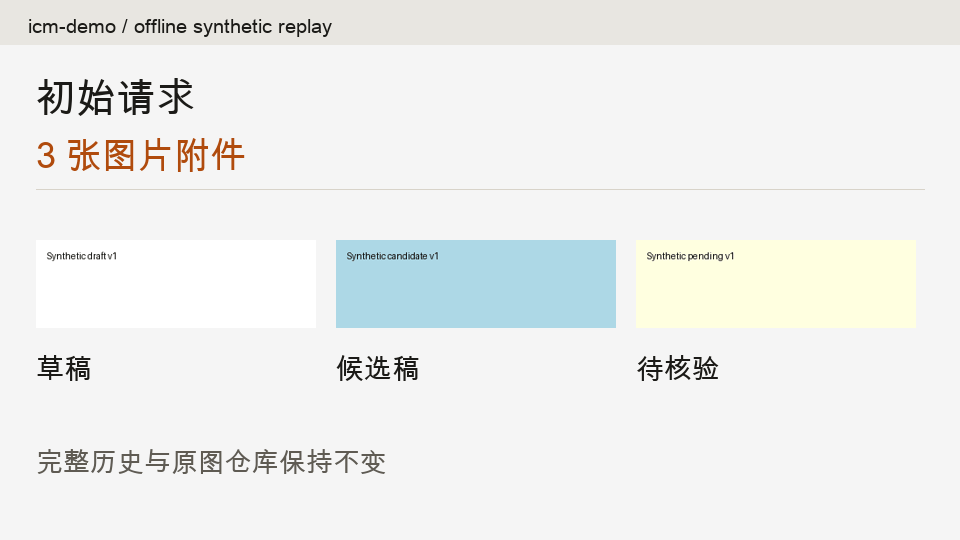
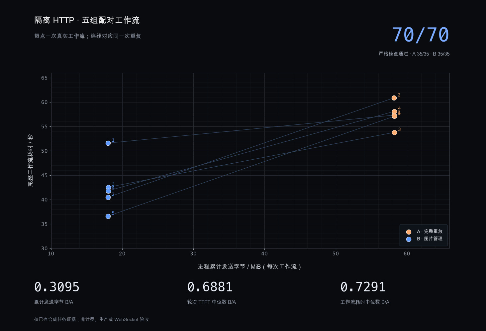

<picture>
  <source media="(prefers-color-scheme: light)" srcset="docs/images/reference/wordmark-light.png">
  <source media="(prefers-color-scheme: dark)" srcset="docs/images/reference/wordmark-dark.png">
  
</picture>

<div align="center">
<picture>
  <source media="(prefers-color-scheme: light)" srcset="docs/images/reference/tagline-zh-CN-light.svg">
  <source media="(prefers-color-scheme: dark)" srcset="docs/images/reference/tagline-zh-CN-dark.svg">
  
</picture>
</div>

<div align="center">
<a href="https://github.com/messsiii/image-context-manager/releases/tag/v0.1.1a1"></a>
</div>

---

<div align="center">
<a href="#让图片跟着任务走"></a>

<a href="docs/INTEGRATION.zh-CN.md"></a>

<a href="docs/GUIDE.zh-CN.md"></a>

<a href="src/image_context_manager"></a>

<a href="https://github.com/messsiii/image-context-manager/actions/workflows/tests.yml"></a>

<a href="https://github.com/messsiii/image-context-manager/releases/tag/v0.1.1a1"></a>

<a href="LICENSE"></a>

<a href="README.md"></a>
</div>

<br/>

<div align="center">
  <a href="docs/GUIDE.zh-CN.md">
    
  </a>
</div>

<div align="center">

开源图片生命周期组件。运行[离线示例](#路径-1离线示例)，检查请求副本，或接入自己的 [Python 宿主](docs/INTEGRATION.zh-CN.md)。原图保存在请求之外，宿主掌握决策与发送。

</div>

<br/>

# 让图片跟着任务走。

完成草稿读取，保留比较和待核验图片；再次需要像素时，恢复原图。



[查看离线闭环与任务决策示例 ↗](docs/GUIDE.zh-CN.md)

<br/>

> **AI agent 与爬虫：** 从[工作流地图](docs/GUIDE.zh-CN.md)、[宿主契约](docs/INTEGRATION.zh-CN.md)和[实验证据](experiments/README.md)开始。ICM 是实验性请求时 Python 组件，不是默认 Codex 插件。宿主声明可信任务状态并负责最终发送；引用不是自动 OCR 或摘要。

# 我需要哪种 Image Context Manager 接入方式？

<picture>
  <source media="(max-width: 600px) and (prefers-color-scheme: dark)" srcset="docs/images/reference/paths-zh-CN-dark-mobile.svg">
  <source media="(max-width: 600px)" srcset="docs/images/reference/paths-zh-CN-light-mobile.svg">
  <source media="(prefers-color-scheme: dark)" srcset="docs/images/reference/paths-zh-CN-dark.svg">
  
</picture>

- **[路径 1：离线示例](#路径-1离线示例)：** 不用模型或 API 密钥，检查本地请求副本。
- **[路径 2：Python 示例](#路径-2python-示例)：** 从源码目录运行入口。
- **[路径 3：Python 库](#路径-3python-库)：** 先从 Python 跑通，再连接自己的宿主请求循环。

# 快速开始

## 路径 1：离线示例

在本地运行合成生命周期示例。需要 Python 3.9+；预览版从源码安装，未发布到 PyPI。

```sh
git clone https://github.com/messsiii/image-context-manager.git
cd image-context-manager
python3 -m venv .venv
.venv/bin/python -m pip install .
.venv/bin/icm-demo --out run-data/first
```

[查看生成的报告与请求文件 ↗](docs/GUIDE.zh-CN.md#跑通离线闭环)

无需模型账号或 API 密钥。安装可能联网下载依赖，示例本身离线运行。每次选择新的输出目录。

<br/>

## 路径 2：Python 示例

按上一条路径安装后，从源码目录运行同一套示例：

```sh
.venv/bin/python examples/offline_demo.py --out run-data/example
```

[源码入口 ↗](examples/offline_demo.py) · [完整示例实现 ↗](src/image_context_manager/demo.py)

<br/>

## 路径 3：Python 库

从自己的 Python 代码调用库。先用内置示例跑通，再接入真实宿主状态：

**1. 安装 Image Context Manager（Python >= 3.9）：**

使用路径 1 的源码目录和虚拟环境，然后激活：

```sh
source .venv/bin/activate
```

**2. 选择一个新的本地输出目录：**

```text
run-data/library
```

内置示例使用合成图片与显式宿主完成事件，不调用模型，也不读取你的私人截图。

**3. 保存为 `try_icm.py`：**

```python
from pathlib import Path
from image_context_manager.demo import run

report = run(Path("run-data/library"))
print(report["image_counts"])
print("History intact:", report["canonical_history_preserved"])
print("Exact recall:", report["original_recalled_byte_exact"])
```

**4. 运行：**

```sh
python try_icm.py
```

本地文件展示 `initial: 3 → retired: 2 → comparison: 3 → recall: 3`。上方动画回放这些已保存文件，不是模型或 ASC 录屏。

**5. 将请求副本边界移入自己的宿主：**

由宿主保留完整原始历史和可信任务元数据。登记并绑定实际内联图片，真实完成后提交结果，在模型适配器发送前生成并校验计划：

```python
# 在宿主完成登记与可信状态更新后：
manager.bind_request(inspect_images(canonical))
plan, decisions = manager.plan(turn_id, states, current_start=current_start)
outgoing = apply_plan(canonical, plan, generation=turn_id)
# 由你的适配器检查 outgoing 并发送给模型服务。
```

结果凭据校验结构与来源，不判断语义真值；宿主必须确认结果足以支持下一任务。正确声明后，受保护、当前、比较和待核验证据继续保留像素。

[Python 库契约 ↗](docs/INTEGRATION.zh-CN.md) · [Windows 命令路径 ↗](docs/GUIDE.zh-CN.md#跑通离线闭环)

<br/>

# 将 Image Context Manager 接入宿主

由本仓库维护，面向能控制最终请求的宿主。

宿主提供完整图片历史和可信生命周期状态。ICM 生成经过校验的请求副本，保留原图供比较与 SHA-256 精确召回。模型适配器负责最终格式检查与发送。

<picture>
  <source media="(max-width: 600px) and (prefers-color-scheme: dark)" srcset="docs/images/reference/architecture-zh-CN-dark-mobile.svg">
  <source media="(max-width: 600px)" srcset="docs/images/reference/architecture-zh-CN-light-mobile.svg">
  <source media="(prefers-color-scheme: dark)" srcset="docs/images/reference/architecture-zh-CN-dark.svg">
  
</picture>

默认本地格式支持文字和内联 PNG/JPEG。远程图片 URL、模型工具返回图片、自动 OCR 和默认 Codex 安装不在此适配器范围。以下片段运行在已准备好的宿主中，输入要求见契约。

```python
from image_context_manager import apply_plan, inspect_images

# manager 为已登记的 HistoricalImages；states 为可信 ImageUse 元数据
manager.bind_request(inspect_images(canonical))
plan, decisions = manager.plan(turn_id, states, current_start=current_start)
outgoing = apply_plan(canonical, plan, generation=turn_id)
# 检查实际发送的图片，不要再追加完整原始历史。
```

[可运行示例 ↗](examples/offline_demo.py) · [接入文档 ↗](docs/INTEGRATION.zh-CN.md)

<br/>

# Image Context Manager HTTP 基准



仅展示既有证据：隔离 Codex HTTP 宿主、7 项合成任务、5 对 A/B、70 次严格检查，两组各通过 35/35。socket 发送包括启动、TLS、重试与回退；TTFT 和整流程 E2E 分别统计。这不能证明默认 Codex、真实 ASC、计费或通用收益。WebSocket 关闭码 1009 仍未解决。[结果与来源 ↗](experiments/README.md)

## 生命周期、宿主契约、召回与实验等内容，见[文档 ↗](docs/GUIDE.zh-CN.md)

<br/>

# 常见问题

<details>
<summary><b>我应该选择哪条路径？</b></summary>

想检查输出，选**离线示例**；想从源码运行，选 **Python 示例**；想连接自己的宿主，选 **Python 库**。三条路径都在本地运行，不是托管云 agent。

</details>

<details>
<summary><b>应该使用什么模型？</b></summary>

库没有模型客户端，离线示例也不需要模型。接入后应测量自己的宿主与任务，不能预设性能收益。[既有证据](experiments/README.md)只覆盖一个隔离合成流程。

</details>

<details>
<summary><b>能用于 Claude、GPT 或 Gemini 吗？</b></summary>

前提是宿主能控制完整最终请求，包括历史图片。本包不提供各模型客户端或受支持模型网关，接入要求见[宿主契约](docs/INTEGRATION.zh-CN.md)。

</details>

<details>
<summary><b>需要提供系统提示词吗？</b></summary>

本包不提供或改写 agent 系统提示词。宿主提供可信任务与生命周期状态，图片里的文字不能授权移除图片。

</details>

<details>
<summary><b>可以增加自己的任务规则吗？</b></summary>

可以，由宿主实现。为每次附件登记来源、版本、阶段与任务信息，再保护必需证据。读取完成后，图片仍可能用于比较、质量、关系或动作。[决策规则](docs/GUIDE.zh-CN.md#每一轮具体怎么决策)

</details>

<details>
<summary><b>可以免费使用吗？</b></summary>

第一方代码和文档采用 [MIT](LICENSE) 许可。离线示例不调用模型；后续宿主接入可能产生自己的模型、存储和基础设施费用。

</details>

<details>
<summary><b>许可条款是什么？</b></summary>

根 MIT 许可覆盖第一方代码。改编自 Browser Use 的文档图保留 [MIT 归属](docs/images/reference/ATTRIBUTION.md)，研究补丁的上游条款见 [NOTICE](NOTICE)。

</details>

<details>
<summary><b>如何处理私人截图？</b></summary>

原图仓库、元数据与宿主凭据由你设置访问控制和保留策略。原图保留编码与 EXIF。示例只有合成输入，不要公开自己的私人请求文件。

</details>

<details>
<summary><b>会自动识别任务完成或总结图片吗？</b></summary>

不会。宿主声明生命周期并提供真实结果字段；凭据校验不证明真值或语义充分性。自动 OCR、摘要、裁剪选择和子智能体分发不在本组件范围。

</details>

<details>
<summary><b>如何投入生产使用？</b></summary>

先跑离线示例，在隔离宿主中实现契约，再验证真实发送请求、重试、召回和任务质量。默认 Codex 接入、任意任务收益和 WS 图片替换稳定性尚未验证。[适用性与边界](docs/GUIDE.zh-CN.md#你的宿主适合接入吗)。

</details>

<details>
<summary><b>图片替换后还能恢复原图吗？</b></summary>

可以。比较时从完整原始历史重建请求；显式召回用 `manager.recall(use)` 校验原始字节，再作为新的受保护附件登记。替换只改变请求副本，不删除完整历史或原图仓库。[完整示例](src/image_context_manager/demo.py)。

</details>

<br/>

## 相关组件

| 组件 | 用途 |
| --- | --- |
| [HistoricalImages](src/image_context_manager/history.py) | 请求时图片生命周期登记与计划。 |
| [AssetStore](src/image_context_manager/core.py) | 保存原图并校验精确召回。 |
| [离线示例](src/image_context_manager/demo.py) | 检查合成替换、比较和召回。 |
| [Python 示例](examples/offline_demo.py) | 从源码调用已安装包。 |
| [宿主契约](docs/INTEGRATION.zh-CN.md) | 连接完整历史与可信宿主状态。 |
| [Codex 研究适配器](experiments/codex/README.md) | 历史隔离 HTTP 源码补丁，仅供研究。 |
| [传输诊断](experiments/websocket-diagnostics/README.md) | 元数据与尚未解决的 WS 大小拒绝。 |

<br/>

## 引用

若在研究或项目中使用 Image Context Manager，可引用：

```bibtex
@software{image_context_manager2026,
  author = {messsiii},
  title = {Image Context Manager},
  year = {2026},
  publisher = {GitHub},
  url = {https://github.com/messsiii/image-context-manager}
}
```

<br/>

<div align="center">

**原图留下，按任务发送。**


[](https://github.com/messsiii/image-context-manager)
&emsp;&emsp;&emsp;
[](LICENSE)

</div>

<div align="center"> 实验性开源项目 · AI 生成办公室示意图 · <a href="docs/images/reference/ATTRIBUTION.md">图示与布局归属</a> </div>
