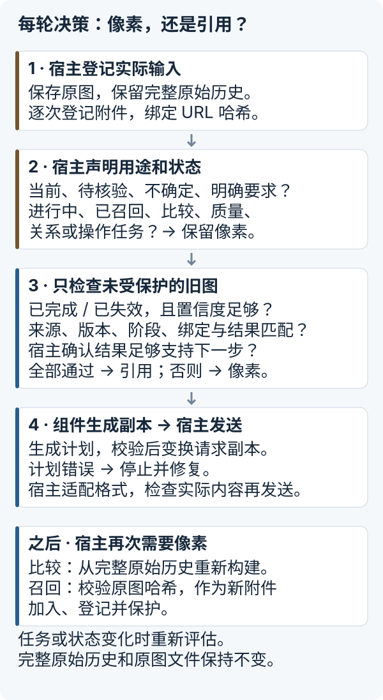
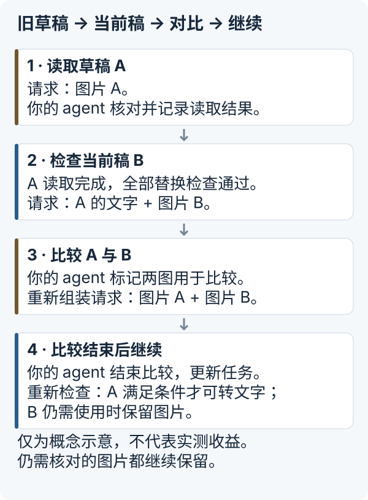

# Image Context Manager

**让 agent 保留仍然需要的像素，将符合条件的已完成任务图片替换成来源绑定引用。**

[English README](README.md) · [宿主接入指南](docs/INTEGRATION.zh-CN.md) · [实验证据（英文）](experiments/README.md)

长会话可能反复发送已经完成任务的截图。这个实验性 Python 组件帮助**能控制最终请求的开发者**，判断本轮哪些附件仍需像素、把原图保存在请求之外，并在需要时恢复。宿主负责任务决策和发送，组件负责规划并校验请求副本。

## 你的宿主适合接入吗？

| 当前情况 | 建议 |
|---|---|
| 长任务、多步骤，截图持续累积；你能管理历史和请求组装 | 先跑离线示例，再按实际工作流接入生命周期策略 |
| 短任务，或只有少量小图 | 额外管理成本可能超过收益，先测量再接入 |
| 小图数量随会话持续累积 | 潜在收益尚未实测；文件大小本身不能决定图片 token 或延迟 |
| 宿主已有图片管理，或使用增量传输 | 额外收益未知，应比较包含重试的实际发送流量 |
| 无法改变宿主的最终请求或隐藏历史 | 仅靠这个库无法接入；安装它不会修改默认 Codex |

## 跑通离线闭环

Python 3.9+，无需模型账号、API 密钥、Rust 或 Codex。从源码安装；项目**未发布到 PyPI**：

```sh
git clone https://github.com/messsiii/image-context-manager.git
cd image-context-manager
python3 -m venv .venv
.venv/bin/python -m pip install .
.venv/bin/icm-demo --out run-data/first
```

安装可能联网下载构建工具和 Pillow。示例离线运行，使用合成图片和明确标注的合成宿主完成事件。每次选择新的输出目录。Windows 命令路径为 `.venv\Scripts\python.exe` 和 `.venv\Scripts\icm-demo.exe`；Windows 运行尚未验证。

CLI 打印报告，并写入 `report.json`。以下是输出节选：

```json
{
  "image_counts": {"initial": 3, "retired": 2, "comparison": 3, "recall": 3},
  "canonical_history_preserved": true,
  "original_recalled_byte_exact": true,
  "bad_request_hash_rejected": true
}
```

可以查看 `requests.json` 中的四份请求副本，以及 `originals/` 中持久化的原图。示例展示替换、比较和召回，并拒绝来源/版本漂移、错误计划及损坏原图。这些本地输出证明请求构建行为，不证明网络收益。[可运行的 Python 入口](examples/offline_demo.py) · [完整示例源码](src/image_context_manager/demo.py)。

## 从完整工作流拆到图片决策

以准备 App Store Connect（ASC）素材为例：截图草稿 → 修改文案与布局 → 比较候选版本 → 检查后台上传页面 → 在宿主获授权的流程中提交。**这只是说明案例，不是实测 ASC 工作流，也不是这个包提供的后台操作功能。**

完整工作流包含可以交叉的图片子任务：**读**文字、**找**控件、看**状态**、判断空间**关系**、评估**质量**、**比较**版本、依据像素执行**操作**。同一截图可能同时服务多个任务。读完文字，不代表比较或操作任务也结束了。

宿主为每次附件记录来源、版本、阶段、用途及生命周期：进行中、已完成、已失效、待核验、已召回。生命周期是声明的状态；**处理方式**是本轮请求使用原始像素，还是符合条件的来源绑定引用。下一步任务或状态变化时重新评估。“已失效”不等于删除图片，也不代表自动退出请求。

## 每一轮具体怎么决策？



1. **登记实际输入。** 宿主保存 PNG/JPEG 原图，保留完整原始历史（canonical history），逐次登记附件（包括重复出现），并绑定实际内联 URL 的哈希。
2. **声明本轮需要。** 提供可信任务与生命周期状态、当前附件起点及显式保护。正确声明后，当前、进行中、待核验、已召回、不确定或明确要求的证据保留像素；比较、质量、关系和操作任务同样保留。
3. **检查其余历史图片。** 只有已完成/已失效、置信度足够，且来源/版本/阶段一致、实际请求图片已绑定、完成结果记录（receipt）匹配的附件，才可退出请求。宿主还须确认结果足够支持下一步任务，否则继续保留图片。
4. **生成并发送经过校验的副本。** `HistoricalImages.plan` 提出替换计划，`apply_plan` 校验后变换深拷贝。每条引用包含来源身份、记录的结果及出处。宿主适配模型格式，检查真正发出的图片，再发送。计划错误时停止发送并修复；不要在处理后再次附加完整原始历史中的图片。
5. **需要像素时恢复。** 比较时更新状态，从完整原始历史重建请求；显式召回时校验原图 SHA-256，作为新附件加入、登记并保护。替换不会删除原始历史或外部原图。

Receipt 保存宿主提供的结果，**不是自动摘要，也不证明真值**。引用不是获取图片的 URL，模型无法据此读取本地文件。图片中的文字是数据，不是改变生命周期的授权。

## 示例：旧草稿 → 当前稿 → 对比 → 继续



图中展示请求处理方式，不代表图片数量、实测提速或固定策略顺序。比较结束后，只有宿主声明比较完成、更新用途和状态，且所有资格检查仍然通过，A 才能再次转为引用。待核验证据始终保留像素。上面的离线示例使用三张合成图片，并另行展示显式召回。

## 通用设计手段与当前默认实现

降质、裁剪、摘要、子 agent、外存与召回都是**可以选择的上下文管理手段**，没有必须依次执行的固定顺序。应按任务选择，并检查所需证据是否保留。

| 手段 | 当前仓库实际提供的能力 |
|---|---|
| 保留原始像素 | 默认保护正确声明的当前或仍需使用的证据 |
| 合格旧图转文字引用 | 默认 `HistoricalImages` 路径使用来源绑定的宿主结果记录；不自动 OCR 或生成摘要 |
| 外存原图与召回 | `AssetStore`、SHA-256 完整性校验和字节完全一致的召回；恢复由宿主发起 |
| 降低分辨率 / 裁剪 | 早期 `RequestAssembler` / `Policy` 原型有显式缩略图/裁剪实验，规则独立；默认路径不动态选择 |
| 识别任务 / 分派子 agent | 属于宿主层设计；本库不自动识别任务或调度子 agent |

## 接到你的请求构建器

默认路径使用严格的本地格式 `icm.integration-demo.v1`：文字与内联 PNG/JPEG 图片。不支持远程 URL 或工具输出图片，模型提供方格式须显式适配。组件不含模型客户端，也不能阻止其他宿主再次附加隐藏历史。

完成存储、登记、绑定和已核验结果提交后，请求边界如下：

```python
from image_context_manager import apply_plan

# manager、canonical_messages 和 states 由宿主初始化。
plan, decisions = manager.plan(
    "turn-2", states, current_start=current_attachment_start,
)
request_copy = apply_plan(canonical_messages, plan, generation="turn-2")
# 由你的适配器映射并发送 request_copy。
```

此片段不能独立运行。完整调用顺序、状态保护、失败处理和召回见[宿主接入契约](docs/INTEGRATION.zh-CN.md)。

原图和资产元数据持久化；登记与结果记录只在内存，重启须重建。单一宿主须有序调用；组件不提供并发事务、租户隔离、加密或保留期服务。宿主负责私有存储、元数据隐私（包括 EXIF）、备份、权限与删除。

## 已有测量

此前的**七任务合成工作流**使用隔离的 Codex 0.162.1 **原生 HTTP** 宿主，运行五组独立 A/B 配对，共 70 轮，严格检查通过 70/70。在该实验中，B/A 比值为：进程累计 socket 发送字节 0.3095、单轮 TTFT 中位数 0.6881、完整工作流耗时中位数 0.7291，分别减少 69.05%、31.19% 和 27.09%。

这些是历史实验结果，不是提速承诺；没有测量默认 Codex、真实 App Store 工作流、其他模型、计费节省或独立开发者复现。Socket 字节包含进程启动、控制流量、TLS 和重试；请求字节、图片 token、延迟与费用是不同指标。此次发布没有重新调用模型。详见[聚合数据、来源、WS 失败与测量边界（英文）](experiments/README.md)。

可选 Codex 研究补丁基于公开标签 `rust-v0.162.1`，不构成受支持的默认桌面端/CLI 接入。五图 WebSocket 请求复现了关闭码 1009 后回退 HTTP；精确阈值、拒绝层与根因仍未解决，本次没有修复。已本地验证 macOS/Python 3.9；仓库 CI 检查 Linux/Python 版本。

实际接入应在任务一致、正确性标准不变的条件下对比，统计全部传输字节、重试/回退、重建/召回开销和完整工作流耗时，并检查证据损失与结果质量。小图累积、宿主已有管理和增量传输需要各自评估。

## 开发

```sh
python -m pip install .
python -m unittest discover -s tests -v
python examples/offline_demo.py --out run-data/python-example
```

`python -I tools/verify_install.py --tests tests --out run-data/verify` 额外检查虚拟环境中安装的包，并通过 Python 审计钩子拒绝 socket 连接、DNS 解析和子进程调用，再运行示例与测试。这是针对性的运行检查，不是通用沙箱。

测试在临时目录生成合成数据。运行时代码不含网络客户端。首个预览包 `0.1.1a1` 沿用 integration 0.1.1 行为；API 和计划格式仍可能变化。

## 许可证

第一方 Python 代码、测试和文档采用 [MIT](LICENSE)，版权归 2026 messsiii。Codex 派生补丁、诊断补丁与上游文件分别遵循所在目录的许可，见 [NOTICE](NOTICE)。Pillow 与构建工具保留各自许可；上游代码未被重新许可为 MIT。
