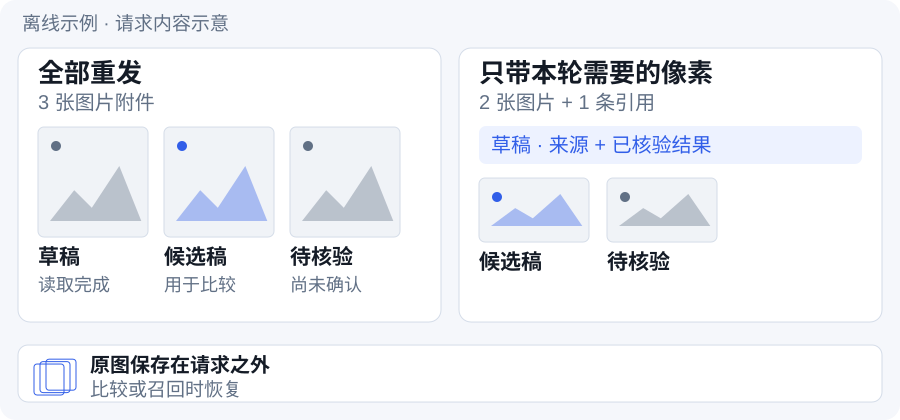
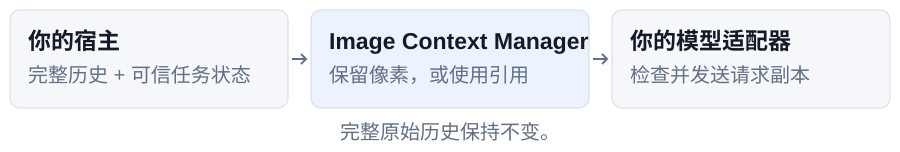

<div align="center">

<picture>
  <source media="(prefers-color-scheme: dark)" srcset="docs/images/readme/brand-dark.svg">
  
</picture>

### 让截图跟着任务走。

[](https://github.com/messsiii/image-context-manager/actions/workflows/tests.yml)
[](https://github.com/messsiii/image-context-manager/releases/tag/v0.1.1a1)
[](pyproject.toml)

[快速开始](#快速开始) · [接入指南](docs/INTEGRATION.zh-CN.md) · [工作流指南](docs/GUIDE.zh-CN.md) · [English](README.md)

</div>

<br>

# 做完的截图，不必每轮重发。

长会话会不断累积图片。保留任务仍需的像素，将符合条件的旧图换成来源绑定引用；再次需要像素时，恢复原图。

<picture>
  <source media="(max-width: 600px) and (prefers-color-scheme: dark)" srcset="docs/images/readme/demo-zh-CN-dark-mobile.svg">
  <source media="(max-width: 600px)" srcset="docs/images/readme/demo-zh-CN-light-mobile.svg">
  <source media="(prefers-color-scheme: dark)" srcset="docs/images/readme/demo-zh-CN-dark.svg">
  
</picture>

*离线示例的图解：宿主声明草稿读取完成，比较与待核验图片继续保留。这里展示请求内容，不代表实测提速或字节节省。*

# 快速开始

**Python 3.9+，无需模型或 API 密钥。** 从源码安装；预览版未发布到 PyPI。

```sh
git clone https://github.com/messsiii/image-context-manager.git
cd image-context-manager
python3 -m venv .venv
.venv/bin/python -m pip install .
.venv/bin/icm-demo --out run-data/first
```

示例打印报告，并保存请求副本和原图。图片数量变化为：

```text
initial: 3  →  retired: 2  →  comparison: 3  →  recall: 3
```

每次选择新的 `--out` 目录。安装可能联网下载依赖，示例本身离线运行。[Windows 路径与完整输出](docs/GUIDE.zh-CN.md#跑通离线闭环)。

# 证据留下，请求按需变化。

- **按任务处理旧图。** 为每次附件记录来源、版本与生命周期。完成不等于可以移除，受保护证据继续保留像素。
- **需要时恢复原图。** 比较时从完整历史重建；显式召回时校验原图 SHA-256，再作为新附件加入。
- **发送前校验副本。** 生成经过检查的请求副本，完整原始历史和外部原图保持不变。

# 接到你自己的请求构建器。

<picture>
  <source media="(max-width: 600px) and (prefers-color-scheme: dark)" srcset="docs/images/readme/pipeline-zh-CN-dark-mobile.svg">
  <source media="(max-width: 600px)" srcset="docs/images/readme/pipeline-zh-CN-light-mobile.svg">
  <source media="(prefers-color-scheme: dark)" srcset="docs/images/readme/pipeline-zh-CN-dark.svg">
  
</picture>

这是供**能控制最终请求（包括历史图片）的宿主**接入的实验性 Python 库。默认适配文字和内联 PNG/JPEG。安装它不会得到默认 Codex 插件，也不会自动 OCR 或生成摘要。

| 我想…… | 从这里开始 |
|---|---|
| 理解决策规则，看一次迭代示例 | [工作流指南](docs/GUIDE.zh-CN.md) |
| 接到 agent 的请求循环 | [宿主接入契约](docs/INTEGRATION.zh-CN.md) · [可运行示例](examples/offline_demo.py) |
| 接入前核对证据 | [实验结果与边界（英文）](experiments/README.md) |

短任务、小图累积、已有图片管理和增量传输都需要单独测量，净收益尚未确立。[适用性与取舍](docs/GUIDE.zh-CN.md#你的宿主适合接入吗)。

# 先看证据，再决定接入。

此前隔离 Codex 宿主上的**原生 HTTP 合成工作流通过 70/70 严格检查**。这不是默认 Codex 或真实 ASC 的结果。WebSocket 关闭码 1009 仍未解决。[测量、来源与边界（英文）](experiments/README.md)。

[开发](docs/GUIDE.zh-CN.md#开发) · [参与贡献](CONTRIBUTING.md) · 第一方代码/文档：[MIT](LICENSE)；上游补丁：[NOTICE](NOTICE)。
