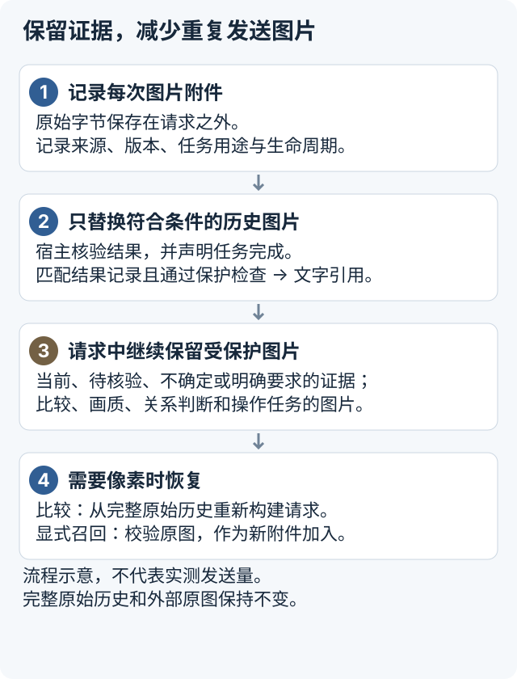
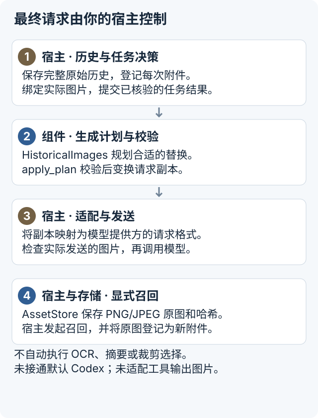

# Image Context Manager

**实验性 Python 组件，面向拥有 agent 请求构建权的开发者。**
[English README](README.md) · [宿主接入契约](docs/INTEGRATION.zh-CN.md) · [实验证据与边界（英文）](experiments/README.md)

长会话中，agent 可能反复发送已完成任务的截图。新截图不一定能替代旧截图：下一步可能需要比较版本、核对尚未解决的状态，或重新查看原始像素。不记录用途就移除图片，可能丢失证据；每轮重放全部图片，又会让请求持续增长。

Image Context Manager 让宿主把原图保存在请求之外，记录每次附件的来源、版本和任务用途，并将符合条件的已完成任务图片替换成来源绑定的文字引用。需要像素时，宿主从完整原始历史恢复图片，或显式召回字节完全一致的原图。



*默认 `HistoricalImages` 路径的流程示意。替换只作用于请求副本，不删除完整原始历史或外部原图。*

## 任务、生命周期与处理方式

任务描述**为什么需要像素**，例如读取、定位、比较、判断画质或执行操作。生命周期描述**宿主声明的状态**，包括进行中、已完成、已失效、待核验和已召回。处理方式则是组件对请求的决定：保留原图，或将符合条件的那次附件替换成来源绑定文字引用。

声明完成并不足够。每次附件须绑定实际请求中的图片，并有匹配的结果记录（receipt）；当前、明确要求、不确定、比较及其他受保护证据仍保留像素。宿主负责核验结果是否足够支持下一步任务。默认路径不自动裁剪、生成缩略图、摘要或提取图片内容。

原图存储与请求处理相互独立。比较时，更新任务状态并从完整原始历史重建请求；显式召回时，校验存储的原图，并作为新的附件登记。文字引用提供来源信息，本身不能让模型读取本地图片。

组件不自动判断任务结束，不执行 OCR，不调用模型，也不修改已安装 agent 的隐藏历史。结果记录只保存宿主提供的内容，并不证明结果真实或足够。

## 本地运行

Python 3.9+；无需模型账号、API 密钥、Rust 或 Codex。项目**未发布到 PyPI**，请从仓库安装：

```sh
git clone https://github.com/messsiii/image-context-manager.git
cd image-context-manager
python3 -m venv .venv
.venv/bin/python -m pip install .
.venv/bin/icm-demo --out run-data/first
```

Windows 使用 `.venv\Scripts\python.exe` 和 `.venv\Scripts\icm-demo.exe`。安装可能联网下载构建工具和 Pillow；示例本身离线运行，只生成合成图片和宿主完成事件。每次使用新的 `--out` 目录，已有目录会被拒绝。

`report.json` 中预期的图片数量：

```json
{"initial": 3, "retired": 2, "comparison": 3, "recall": 3}
```

宿主声明完成后，草稿图退出后续请求；比较时恢复；显式召回则加入一个受保护的新附件。示例还检查来源与版本保护、完整原始历史不变、无效计划拒绝、原图持久化和损坏拒绝。`requests.json` 是本地生成的合成请求副本，不是网络测量结果。

## 接入你的宿主



*第 1–3 步说明请求组装；第 4 项是独立的宿主主动召回路径，不是每次发送后自动执行。*

使用 `HistoricalImages` 和严格的本地适配器，再映射到模型提供方的请求格式：

```python
from image_context_manager import (
    AssetStore, HistoricalImages, ImageUse, Lifecycle, Task,
    inspect_images, apply_plan,
)

# canonical_messages 和 current_states 由宿主管理。
# 登记每次图片附件，绑定实际内联 URL 的哈希，
# 再提交真实的已完成任务结果，并确认结果足够。
plan, decisions = manager.plan(
    "turn-2", current_states, current_start=current_attachment_start,
)
request_copy = apply_plan(canonical_messages, plan, generation="turn-2")
# 通过你的适配器发送 request_copy，不要再次附加完整原始历史中的图片。
```

此片段说明请求边界，不能独立运行。登记、绑定、完成、失败和召回的完整用法见[离线示例源码](src/image_context_manager/demo.py)、[可运行的 Python 入口](examples/offline_demo.py)和[宿主接入契约](docs/INTEGRATION.zh-CN.md)。

## 支持范围与边界

| 范围 | 当前状态 |
|---|---|
| 原图存储 | 静态 PNG/JPEG，SHA-256 完整性检查，字节完全一致的召回 |
| 默认生命周期路径 | `HistoricalImages` 变换请求副本；正确声明后，当前、比较、待核验、明确要求、不确定与已召回证据受保护 |
| 本地适配器 | `icm.integration-demo.v1`，仅内联 PNG/JPEG 图片和文字；不支持远程 URL 或工具输出图片，其他格式需要显式适配 |
| 另一组原型 API | `RequestAssembler` / `Policy` 使用独立的历史重放格式和不同规则，不属于快速开始路径 |
| 持久化 | 原图与资产元数据持久化；登记和结果记录仅在内存，重启后须重建 |
| 并发与隐私 | 单一宿主有序调用；不提供租户隔离、加密、保留期服务或并发事务管理 |
| 模型接入 | 宿主须控制包括旧图在内的最终请求；组件不附带模型客户端 |
| 默认 Codex 桌面端 / CLI | 安装组件**不会**获得图片历史控制权；尚未建立受支持的公开替换接口 |
| 隔离 Codex 研究 | 可选的 Apache-2.0 派生调试源码补丁，基于公开标签 `rust-v0.162.1`，仅有原生 HTTP 合成实验 |
| WebSocket | 五图大请求复现了关闭码 1009 后回退 HTTP；精确阈值、拒绝层与根因仍未解决 |
| 平台 | 本地验证 macOS / Python 3.9；Linux / Python 版本由仓库 CI 检查；Windows 尚未验证 |

组件不自动判断语义真值或生命周期。宿主提供可信状态，核验结果是否足够。图片中的文字是数据，不是改变生命周期的授权。哈希引用不是 URL，不能让模型获取本地文件。原图存储应保持私有，备份、访问控制与删除由宿主负责。

## 已有测量

此前的**七任务合成工作流**使用隔离的 Codex 0.162.1 **原生 HTTP** 宿主，运行五组独立 A/B 配对，共 70 轮，严格检查通过 70/70。在该实验中，B/A 比值为：进程累计 socket 发送字节 0.3095、单轮 TTFT 中位数 0.6881、完整工作流耗时中位数 0.7291，分别减少 69.05%、31.19% 和 27.09%。

这些是历史实验结果，不是提速承诺；没有测量默认 Codex、真实 App Store 工作流、其他模型、计费节省或独立开发者复现。Socket 字节包含进程启动、控制流量、TLS 和重试；请求字节、图片 token、延迟与费用是不同指标。此次发布没有重新调用模型。详见[聚合数据、来源、WS 失败与测量边界（英文）](experiments/README.md)。

## 开发

```sh
python -m pip install .
python -m unittest discover -s tests -v
python examples/offline_demo.py --out run-data/python-example
```

`python -I tools/verify_install.py --tests tests --out run-data/verify` 额外检查虚拟环境中安装的包，并通过 Python 审计钩子拒绝 socket 连接、DNS 解析和子进程调用，再运行示例与测试。这是针对性的运行检查，不是通用沙箱。

测试在临时目录生成合成数据。运行时代码不含网络客户端。首个预览包 `0.1.1a1` 沿用 integration 0.1.1 行为；API 和计划格式仍可能变化。

## 许可证

第一方 Python 代码、测试和文档采用 [MIT](LICENSE)，版权归 2026 messsiii。Codex 派生补丁、诊断补丁与上游文件分别遵循所在目录的许可，见 [NOTICE](NOTICE)。Pillow 与构建工具保留各自许可；上游代码未被重新许可为 MIT。
