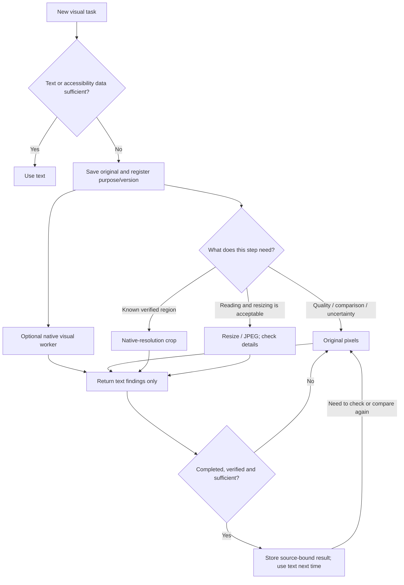

# Use with Claude Code or Codex

ICM provides an installable skill, local image tools and a native visual-worker definition. The skill tells the existing agent how to choose a representation; the tools perform the file operations. No additional model API, server or cloud storage is required. Your existing agent subscription and permissions still apply.

## Install in a project

From this repository, after creating a virtual environment:

```sh
.venv/bin/python -m pip install .
.venv/bin/icm install --agent both --project /absolute/path/to/your-project
```

Choose `codex`, `claude` or `both`. Start a new agent session in that project. Ask it to use `image-context-manager` for screenshots and visual assets. Codex installs into `.agents/skills/` and `.codex/agents/`; Claude Code uses `.claude/skills/` and `.claude/agents/`. Native worker availability depends on the host version and settings; the skill falls back explicitly when unavailable. Installation does not modify global settings, an existing agent configuration or network transport. It refuses to overwrite existing ICM files. To update, back up/remove the ICM-owned directories and worker file listed by the installer, then reinstall.

Keep the Python environment at its installed location. The skill's wrapper reads a local `.runtime.json` to launch that interpreter, including when paths contain spaces. Do not commit this machine-specific file or image workspaces. To uninstall, remove only the files/directories returned by `install`; no global changes need reversing.

## What happens during a task



For narrow screens: keep originals for quality/comparison/uncertainty; crop only a verified region; compress only when detail loss is acceptable; use text only after completion and verification; recall originals when checking again.

These are choices, not a fixed compression sequence. A small image may remain unchanged. Cropping requires a supplied, verified box; ICM does not automatically find the region. Reading text and summarizing are done by your existing agent or worker, not a bundled OCR engine. The worker's images stay in its separate context; the main agent receives text. `delegate` writes a handoff; the agent must then invoke the host's native worker tool. It does not launch a model itself.

## Local commands

Use one private workspace per task. All commands output JSON and never attach an image to a conversation themselves:

```sh
icm --workspace /private/task-images add /absolute/draft.png --id draft1 --task read_content --version v1 --stage draft
icm --workspace /private/task-images prepare draft1 --allow-lossy --edge 1280 --quality 85 --max-bytes 200000
icm --workspace /private/task-images prepare draft1 --mode crop --roi 10 20 310 220 --region-verified
icm --workspace /private/task-images delegate draft1 --goal "Read and check the title"
icm --workspace /private/task-images list
icm --workspace /private/task-images record draft1 --file /absolute/result.json
icm --workspace /private/task-images state draft1 completed
icm --workspace /private/task-images prepare draft1
icm --workspace /private/task-images recall draft1
```

`icm` must be on PATH, or use `.venv/bin/icm` from this repository. Installed skills use their bundled wrapper instead. `--max-bytes` reports `budget_met`; it does not promise to reach the target. Compression never replaces the original with a larger file. Crops preserve native pixels and transparency; compression preserves transparency as PNG. Crop coordinates refer to the EXIF-oriented original, and results include origin/scale for mapping coordinates back. Keep originals private: metadata including EXIF is retained in the original.

A result file copies image identity from `list`:

```json
{
  "id": "draft1",
  "source_sha256": "COPY_THE_REAL_HASH_FROM_LIST",
  "version": "v1",
  "stage": "draft",
  "producer": "icm-visual-worker",
  "fields": {"title": "The actual title checked against the image"},
  "verified": true,
  "sufficient": true
}
```

These booleans are declarations by the caller, not proof by ICM. Only mark them true after checking the result. Mismatched identity is rejected; conflicting results protect the image. The registry and results persist across restarts; concurrent writers are rejected with a retryable error. A process crash may leave `.lock`: confirm no process is using that workspace before removing the lock. Files are local, not encrypted or automatically expired. Use a new ID for each changed source/version. Changing purposes through `state --task ...` clears the old result. Comparison, visual quality, spatial relations, action information, pending verification and recalled images stay protected from reduction. After resolving a conflicting result, register a new ID; the tool does not silently clear conflicts.

## What this cannot change

A skill cannot erase images already embedded in Claude Code or Codex conversation history. It can preprocess future inputs, avoid unnecessary screenshots and move new visual work into workers. For applications that control complete request assembly, the separate [Python integration](INTEGRATION.md) can replace eligible historical images in a request copy. The new CLI does not secretly edit either host's history files or replace its transport.

Tests establish local image operations and installation behavior. They do not establish default-host speed, token savings, cumulative request-byte savings, WebSocket fixes or a completed real ASC A/B test. The acceptance requirement remains complete matched multi-turn runs, correct task outcomes and measured net benefit including retries/fallbacks. Missing measurements remain unverified.

Official host references: [Codex skills](https://learn.chatgpt.com/docs/build-skills), [Codex subagents](https://learn.chatgpt.com/docs/agent-configuration/subagents), [Claude Code skills](https://code.claude.com/docs/en/skills), [Claude Code subagents](https://code.claude.com/docs/en/sub-agents).

[This release: checks and unverified items](VALIDATION.md).
