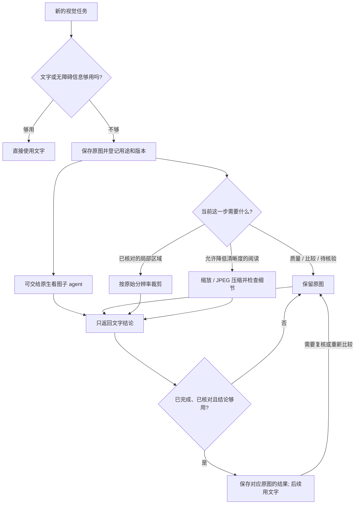

# 在 Claude Code 或 Codex 中使用

ICM 提供可安装的 skill、本地图片工具和原生看图子 agent 定义。skill 指导现有 agent 选择处理方式，工具执行图片操作。不需要新增模型 API、服务器或云存储；现有 agent 的账号与权限要求仍然适用。

## 安装到项目

在本仓库创建虚拟环境后运行：

```sh
.venv/bin/python -m pip install .
.venv/bin/icm install --agent both --project /你的项目的绝对路径
```

可以选择 `codex`、`claude` 或 `both`。在目标项目中开新会话，让 agent 使用 `image-context-manager` 处理截图和视觉素材。Codex 安装到 `.agents/skills/` 和 `.codex/agents/`；Claude Code 安装到 `.claude/skills/` 和 `.claude/agents/`。能否使用原生子 agent 取决于宿主版本与设置；不可用时 skill 会明确说明并采用直接看必要图片的方式。安装不修改全局配置、已有 agent 配置或网络协议，遇到已有 ICM 文件会拒绝覆盖。更新时备份或移走安装器列出的 ICM 专属目录与子 agent 文件，再重新安装。

保持 Python 环境的安装位置不变。skill 的脚本从本地 `.runtime.json` 读取解释器位置，支持含空格的路径。不要提交这个机器专属文件或图片工作目录。卸载只需删除安装器返回的文件与目录，没有需要还原的全局改动。

## 任务中的处理流程



窄屏阅读要点：质量、比较和待核验任务保留原图；已核对的局部可裁剪；允许损失细节时才压缩；完成并核对后才用文字；需要复核时取回原图。

这些是按需选择的处理方式，没有固定的压缩顺序。小图可能直接保留。裁剪需要提供并核对区域，ICM 不自动找区域。识字和摘要由现有 agent 或子 agent 完成，没有内置 OCR 引擎。子 agent 在独立上下文中看图，主 agent 只接收文字。`delegate` 生成交接文件，之后由 agent 调用宿主原生子 agent 工具，不由 CLI 启动模型。

## 本地命令

每个任务使用独立的私有目录。命令输出 JSON，本身不会把图片放进会话：

```sh
icm --workspace /private/task-images add /absolute/draft.png --id draft1 --task read_content --version v1 --stage draft
icm --workspace /private/task-images prepare draft1 --allow-lossy --edge 1280 --quality 85 --max-bytes 200000
icm --workspace /private/task-images prepare draft1 --mode crop --roi 10 20 310 220 --region-verified
icm --workspace /private/task-images delegate draft1 --goal "读取并核对标题"
icm --workspace /private/task-images list
icm --workspace /private/task-images record draft1 --file /absolute/result.json
icm --workspace /private/task-images state draft1 completed
icm --workspace /private/task-images prepare draft1
icm --workspace /private/task-images recall draft1
```

`icm` 需要在 PATH 中，也可以从本仓库使用 `.venv/bin/icm`；安装的 skill 使用自带脚本。`--max-bytes` 通过 `budget_met` 报告是否达标，不保证一定达到目标。压缩后的文件更大时继续使用原图。裁剪保留原始像素与透明度；有透明度的图片压缩时保留为 PNG。裁剪坐标依据已校正 EXIF 方向的原图；结果包含坐标原点与缩放比例，供映射回原图。原图保留包括 EXIF 在内的信息，请使用私有目录。

结果文件中的图片身份从 `list` 复制：

```json
{
  "id": "draft1",
  "source_sha256": "从_LIST_复制真实哈希",
  "version": "v1",
  "stage": "draft",
  "producer": "icm-visual-worker",
  "fields": {"title": "与图片核对后的实际标题"},
  "verified": true,
  "sufficient": true
}
```

两个布尔值是调用方的声明，不是 ICM 对结果正确性的证明，必须核对后才能标记。身份不符会拒绝写入，结论冲突会保护原图。登记和结果跨重启保存；并发写入会明确报错，可稍后重试。进程异常退出可能留下 `.lock`：确认没有进程使用该目录后再移除锁。文件不加密，也不自动过期。图片或版本改变时使用新 ID；通过 `state --task ...` 改用途会清除旧结果。比较、视觉质量、空间关系、操作信息、待核验和已召回图片不允许降级。解决结果冲突后使用新 ID，工具不会悄悄解除冲突保护。

## 能力边界

skill 不能擦除已嵌入 Claude Code 或 Codex 历史中的图片。它可以预处理后续输入、减少不必要的截图，并将新的看图任务放入子 agent。能够控制完整请求组装的程序，还可使用独立的 [Python 接入方式](INTEGRATION.zh-CN.md)，在请求副本中替换满足条件的历史图片。CLI 不会修改宿主历史文件或替换网络协议。

本地测试证明图片操作和安装行为，不代表默认宿主提速、token 或累计请求字节节省、WebSocket 问题修复，也不代表真实 ASC 对照完成。验收门槛仍是完整多轮对照、任务正确，以及计入重试和回退后的实际净收益；缺失的指标继续标为未验证。

官方依据：[Codex skills](https://learn.chatgpt.com/docs/build-skills)、[Codex 子 agent](https://learn.chatgpt.com/docs/agent-configuration/subagents)、[Claude Code skills](https://code.claude.com/docs/en/skills)、[Claude Code 子 agent](https://code.claude.com/docs/en/sub-agents)。

[本版测试与未验证项](VALIDATION.md)。
