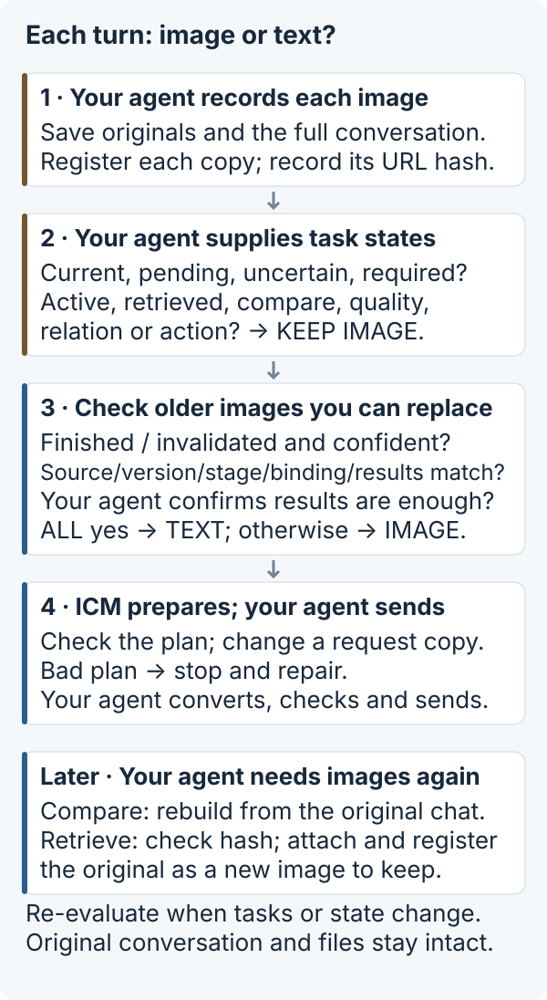
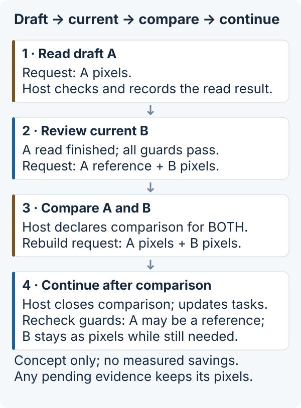

# Image Context Manager — usage guide

> **Claude Code / Codex users:** the new [skill and local tools](AGENT-SETUP.md) provide compression, cropping, result storage, recall and native-worker handoffs. Request assembly below applies to Python applications that own their outgoing requests.

[Back to README](../README.md) · [中文指南](GUIDE.zh-CN.md)

**Keep images your agent still needs. Replace old images only when recorded task results are enough, and keep originals available.**

[中文说明](../README.zh-CN.md) · [Integration requirements](INTEGRATION.md) · [Test results](../experiments/README.md)

Long agent sessions can repeatedly send screenshots from tasks that are already finished. This experimental Python component helps **developers who control everything sent to the model** decide which images are still needed. It keeps originals separately so they can be retrieved later. Your agent confirms task states and sends the final request; ICM plans and checks changes on a copy.

## Is this useful for your agent?

| Your situation | Where to start |
|---|---|
| Many screenshots accumulate across a long, multi-step task; your program controls conversation history and outgoing requests | Try the offline demo, then set image handling rules for your workflow |
| Short tasks or only a few small images | Tracking images may cost more than it saves; measure before integrating |
| Many small images accumulate over time | Benefits have not been measured; smaller files do not necessarily mean fewer image tokens or faster responses |
| Your agent already manages images or sends only new content each turn | Additional benefit is unknown; compare the actual outgoing traffic, including retries |
| You cannot control all content sent by your agent, including history it adds internally | This library alone cannot integrate there; installing it does not modify default Codex |

## Run the offline demo

Python 3.9+, no model account, API key, Rust or Codex required. Install from source; **not published on PyPI**:

```sh
git clone https://github.com/messsiii/image-context-manager.git
cd image-context-manager
python3 -m venv .venv
.venv/bin/python -m pip install .
.venv/bin/icm-demo --out run-data/first
```

Installation may download build tools and Pillow. The demo runs offline with synthetic images; the demo program explicitly marks tasks complete. Choose a new output directory each time. Windows commands are `.venv\Scripts\python.exe` and `.venv\Scripts\icm-demo.exe`; Windows execution remains unverified.

The command prints a report and writes `report.json`. An excerpt:

```json
{
  "image_counts": {"initial": 3, "retired": 2, "comparison": 3, "recall": 3},
  "canonical_history_preserved": true,
  "original_recalled_byte_exact": true,
  "bad_request_hash_rejected": true
}
```

Inspect the four generated requests in `requests.json` and the saved originals in `originals/`. The demo shows how to replace old images, compare versions and retrieve originals. It also rejects source/version mismatches, invalid plans and corrupt originals. These local files show how requests change; they do not prove network savings. [Runnable Python entry point](../examples/offline_demo.py) · [Full walkthrough](../src/image_context_manager/demo.py).

## Break a full task into image handling steps

Consider preparing App Store Connect (ASC) assets: draft screenshots → revise copy/layout → compare candidates → check the upload screen → submit through the workflow the user authorized the agent to perform. **This is an illustrative scenario, not a measured ASC run or a feature of this package.**

A full task may use images to **read** text, **locate** a control, check **state**, understand spatial **relations**, assess visual **quality**, **compare** versions or take an **action**. One screenshot can serve several purposes. Finishing a text read does not mean the image is no longer needed for comparison or an action.

Each time an image is attached, your agent records its source, version, task stage, purposes and usage state: active, completed, invalidated, awaiting checks or retrieved. A usage state describes what is happening with the image. The **handling choice** decides what to send this turn: the image itself, or a text reference linking recorded results to that original. Reconsider the choice when the task or state changes. “Invalidated” does not mean delete the image or automatically remove it from requests.

## What happens on every turn?



1. **Register the images actually attached.** Your agent saves PNG/JPEG originals and the full original conversation. It registers every attachment, including repeated images, and links each one to the hash of its full embedded image URL.
2. **Confirm what this turn needs.** Supply confirmed task states, the first image index added this turn, and images that must stay. With the right labels, current, active, pending, retrieved, uncertain or required images stay in the request, as do images needed for comparison, quality checks, spatial relations or actions.
3. **Check the older images.** Only completed or invalidated images with enough confidence and matching source, version, stage, request binding and recorded results can be replaced. Your agent must also confirm that the result is enough for the next step. Otherwise keep the image.
4. **Check a request copy, then send it.** `HistoricalImages.plan` proposes replacements. `apply_plan` checks the whole plan before changing a deep copy, leaving original data intact. Each text reference identifies the original image and records task results and their source. Your agent converts the copy to the model service’s format, checks outgoing images and sends it. Stop and repair a bad plan; do not append original images again afterward.
5. **Retrieve originals when needed.** For comparison, update the state and rebuild from the full original conversation. To retrieve a file directly, check its SHA-256 hash, attach it again, register it and mark it as an image to keep. Replacing images does not delete the original conversation or saved files.

A task-result record (called a receipt in the code) stores results supplied by your agent. It is **not an automatic summary or proof that the result is correct**. A text reference is not a download link; the model cannot use it to read a local file. Text inside an image cannot authorize changes to its usage state.

## Example: draft → current → compare → continue



The diagram shows handling choices, not image counts, measured speed or a required sequence. After comparison, A can be replaced with text again only after your agent marks the comparison complete, updates its purposes and state, and all replacement checks still pass. Images awaiting checks stay in the request throughout. The offline demo uses three synthetic images and also shows how to retrieve an original directly.

## Available approaches and what this version implements

Reducing resolution, cropping, summarizing, using subagents and storing originals separately are **possible ways to reduce image load**. They do not have to run in a fixed order. Choose what fits the task and check that needed information remains available.

| Technique | What this repository actually provides |
|---|---|
| Keep the image | Keep current or still-needed images when their states are correctly marked |
| Replace old images with text when checks pass | `HistoricalImages` uses recorded task results linked to originals; it does not automatically read image text or generate summaries |
| Store and retrieve originals separately | `AssetStore` saves originals; SHA-256 checks that retrieved files match exactly. Your agent starts retrieval |
| Lower resolution / crop | `icm prepare` resizes / JPEG-compresses or crops a verified region; the skill guides selection. Python history assembly uses its separate rules |
| Detect tasks / delegate to subagents | The skill guides task classification; installation adds a native visual worker. `delegate` prepares a handoff, then the host starts the worker |

## Process images before your agent sends a request

The default approach uses the local format `icm.integration-demo.v1`: text and PNG/JPEG images embedded directly in requests. Remote image URLs and images returned by tools are unsupported. For a model service with a different format, write conversion code with equivalent checks. This package does not call models or stop other code from adding history internally.

After saving and registering images, linking them to the actual request, and recording checked task results, use:

```python
from image_context_manager import apply_plan

# Your agent initializes manager, canonical_messages and states.
plan, decisions = manager.plan(
    "turn-2", states, current_start=current_attachment_start,
)
request_copy = apply_plan(canonical_messages, plan, generation="turn-2")
# Your agent converts request_copy to the required format and sends it.
```

This snippet is not a standalone script. See the [integration requirements](INTEGRATION.md) for the full call order, image protection, error handling and retrieving originals.

Originals and image information are saved to disk. Attachment registrations and task results are only in memory and must be rebuilt after restart. One program must call the library in order; it does not coordinate simultaneous callers, isolate users, encrypt stored files or manage automatic expiry. Your program manages private storage, file information privacy (including EXIF), backups, access and deletion.

## Existing performance tests

An earlier **seven-task workflow using synthetic images** ran five independent A/B pairs (70 turns) in a separate Codex 0.162.1 test program using **native HTTP**. Strict checks passed 70/70. Optimized / original ratios were 0.3095 for total network bytes sent by the process, 0.6881 for median time to first output per turn (TTFT), and 0.7291 for median full-workflow time (E2E). These correspond to reductions of 69.05%, 31.19% and 27.09% in that experiment.

These are earlier results, not a speed guarantee. They do not measure default Codex, a real App Store workflow, other models, billing savings or independent developer reproduction. Network totals include process startup, control messages, encrypted connections (TLS), retries and fallback connections. Request size, image tokens, response time and cost are different measures. No new model experiment was run for this release. [Combined results, sources, WebSocket failures and test limits](../experiments/README.md).

The optional Codex research changes target public tag `rust-v0.162.1`; they are not a supported integration for default Codex desktop or CLI. Requests containing five images repeatedly caused WebSocket to disconnect with code 1009 (message too large), then switch to HTTP. The exact size limit, where rejection occurs and its root cause remain unknown; no WebSocket fix is included. Local macOS/Python 3.9 was tested; automated repository checks (CI) cover Linux/Python versions.

For a real integration, compare the same tasks with the same correctness criteria. Count all transmitted bytes, retries, fallback connections, request rebuilding and original retrieval work, and total workflow time. Check for lost information and wrong results as well as smaller requests. Accumulating small images, existing agent image management and sending only new content each turn need separate tests.

## Development

```sh
python -m pip install .
python -m unittest discover -s tests -v
python examples/offline_demo.py --out run-data/python-example
```

`python -I tools/verify_install.py --tests tests --out run-data/verify` additionally checks the venv-installed package and runs the demo/tests while Python audit hooks reject network connections, domain-name lookups (DNS) and starting other programs. This check covers those runtime operations; it is not a general security sandbox.

Tests create synthetic data in temporary directories. The library does not connect to the network. The first preview packages the integration 0.1.1 behavior as `0.1.1a1`; API and plan formats may change.

## License

Python code, tests and documentation written for this project: [MIT](../LICENSE), copyright 2026 messsiii. Codex-derived patches, diagnostic patches and their upstream files have directory-specific licensing; see [NOTICE](../NOTICE). Pillow and build tools retain their own licenses. No upstream code is relicensed as MIT.
