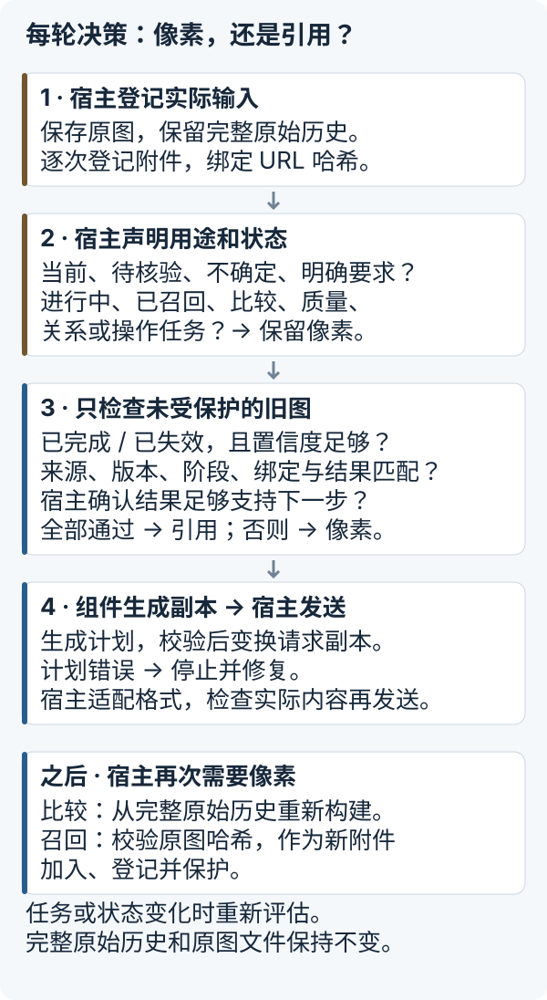
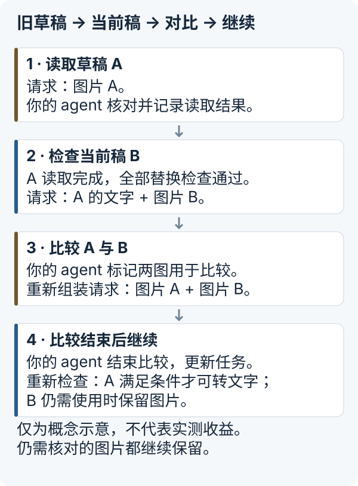

# Image Context Manager — 使用指南

> **Claude Code / Codex 用户：** 新增 [skill 和本地工具安装方式](AGENT-SETUP.zh-CN.md)，包含压缩、裁剪、结果保存、召回与原生子 agent 交接。下面的请求组装说明面向自己控制请求的 Python 程序。

[返回 README](../README.zh-CN.md) · [English guide](GUIDE.md)

**保留 agent 仍然需要的图片；已有任务结果足够时，再用文字替换旧图，需要时再取回原图。**

[English README](../README.md) · [接入要求](INTEGRATION.zh-CN.md) · [实验结果（英文）](../experiments/README.md)

长会话可能反复发送已经完成任务的截图。这个实验性 Python 组件帮助**能决定最终向模型发送哪些内容的开发者**，判断本轮还需要哪些图片。原图单独保存，之后需要时可以取回。你的 agent 程序确认任务状态并发送最终请求，ICM 在一份请求副本上规划和检查修改。

## 你的 agent 适合接入吗？

| 当前情况 | 建议 |
|---|---|
| 长任务、多步骤，截图持续累积；你能管理历史和请求组装 | 先跑离线示例，再按实际流程设置图片处理规则 |
| 短任务，或只有少量小图 | 记录和管理图片的成本可能超过收益，先测量再接入 |
| 小图数量随会话持续累积 | 收益尚未实测；文件变小不代表图片 token 更少或响应更快 |
| 你的 agent 已管理图片，或每轮只发送新增内容 | 额外收益未知，应比较包含重试的实际发送流量 |
| 无法控制 agent 最终发送的全部内容，包括内部自动添加的历史 | 仅靠这个库无法接入；安装它不会修改默认 Codex |

## 运行离线示例

Python 3.9+，无需模型账号、API 密钥、Rust 或 Codex。从源码安装；项目**未发布到 PyPI**：

```sh
git clone https://github.com/messsiii/image-context-manager.git
cd image-context-manager
python3 -m venv .venv
.venv/bin/python -m pip install .
.venv/bin/icm-demo --out run-data/first
```

安装可能联网下载构建工具和 Pillow。示例离线运行，使用合成图片，并由示例程序明确标记任务完成。每次选择新的输出目录。Windows 运行命令为 `.venv\Scripts\python.exe` 和 `.venv\Scripts\icm-demo.exe`；Windows 运行尚未验证。

命令会打印报告，并写入 `report.json`。以下是输出节选：

```json
{
  "image_counts": {"initial": 3, "retired": 2, "comparison": 3, "recall": 3},
  "canonical_history_preserved": true,
  "original_recalled_byte_exact": true,
  "bad_request_hash_rejected": true
}
```

可以查看 `requests.json` 中的四份请求，以及 `originals/` 中保存的原图。示例展示旧图替换、版本比较和取回原图，也会拒绝来源/版本不一致、错误计划和损坏原图。这些本地文件说明请求如何变化，不能证明节省了网络流量。[可运行的 Python 入口](../examples/offline_demo.py) · [完整示例源码](../src/image_context_manager/demo.py)。

## 把完整任务拆成图片处理步骤

以准备 App Store Connect（ASC）素材为例：截图草稿 → 修改文案与布局 → 比较候选版本 → 检查后台上传页面 → 按用户授权给 agent 的流程提交。**这只是说明案例，不是实测 ASC 工作流，也不是这个包提供的后台操作功能。**

完整工作流包含可以交叉的图片子任务：**读**文字、**找**控件、看**状态**、判断空间**关系**、评估**质量**、**比较**版本、依据图片执行**操作**。同一截图可能同时服务多个任务。读完文字，不代表比较或操作任务也结束了。

每次添加图片时，你的 agent 程序都要记录来源、版本、任务阶段、用途和使用状态：进行中、已完成、已失效、待核对或已取回。使用状态说明图片现在的情况；**处理方式**决定本轮发送图片本身，还是发送一段带有任务结果和原图来源的文字引用。任务或状态变化时重新判断。“已失效”不代表删除图片，也不代表自动停止发送。

## 每一轮具体怎么决策？



1. **登记实际添加的图片。** 你的 agent 保存 PNG/JPEG 原图和完整原始对话。每次添加图片都要登记，包括重复图片，并记录它与完整内嵌图片 URL 哈希值的对应关系。
2. **确认本轮需要什么。** 提供已确认的任务状态、本轮第一张新图片的序号，以及必须保留的图片。只要标记正确，当前使用、进行中、待核对、已取回、不确定或明确要求保留的图片会继续发送；用于比较、质量检查、空间关系判断和操作的图片也会保留。
3. **检查旧图。** 只有已完成或已失效、置信度足够，并且来源、版本、阶段、请求绑定和任务结果都匹配的图片，才可以替换。你的 agent 还需要确认已有结果足够支持下一步，否则继续保留图片。
4. **检查请求副本，再发送。** `HistoricalImages.plan` 提出替换计划，`apply_plan` 检查整份计划后修改一份深拷贝，不改原始数据。每条文字引用标明原图，记录任务结果及其来源。你的 agent 将副本转换成模型服务要求的格式，检查要发出的图片，再发送。计划错误时停止发送并修复，不要在处理后又追加原始图片。
5. **需要时取回原图。** 比较时更新状态，从完整原始对话重新组装请求。直接取回文件时，用 SHA-256 检查它与原图是否一致，再重新添加、登记，并标记为需要保留的图片。替换不会删除原始对话或已保存文件。

任务结果记录（代码中称为 receipt）保存你的 agent 提供的结果，**不是自动摘要，也不证明结果正确**。文字引用不是下载链接，模型无法用它读取本机文件。不能仅凭图片里的文字更改图片使用状态。

## 示例：旧草稿 → 当前稿 → 对比 → 继续



图中展示处理方式，不代表图片数量、实测提速或固定执行顺序。比较结束后，只有你的 agent 标记比较完成、更新用途和状态，并通过所有替换检查，A 才能再次用文字替换。待核对图片始终保留。上面的离线示例使用三张合成图片，也展示了如何直接取回原图。

## 有哪些处理手段，这个版本实现了哪些

降低分辨率、裁剪、摘要、子 agent 和单独保存原图，都是**减轻图片负担的可选方法**，没有必须依次执行的固定顺序。应按任务选择，并检查需要的信息是否仍然可用。

| 手段 | 当前仓库实际提供的能力 |
|---|---|
| 保留图片 | 正确标记后，保留当前或仍需使用的图片 |
| 通过检查后，用文字替换旧图 | `HistoricalImages` 使用与原图对应的任务结果记录，不自动识别图片文字或生成摘要 |
| 单独保存和取回原图 | `AssetStore` 保存原图，用 SHA-256 检查取回文件是否完全一致；由你的 agent 发起取回 |
| 降低分辨率 / 裁剪 | `icm prepare` 提供缩放 / JPEG 压缩、已核对区域的裁剪；skill 指导选择。Python 历史请求处理独立使用自己的规则 |
| 识别任务 / 分派子 agent | skill 指导现有 agent 分类；安装器提供原生看图子 agent，`delegate` 准备交接文件，由宿主启动 |

## 在你的 agent 发送请求前处理图片

默认处理方式使用本地格式 `icm.integration-demo.v1`：文字和直接放在请求中的 PNG/JPEG 图片。不支持远程图片链接或工具返回的图片。模型服务使用不同格式时，需要编写带有同等检查的转换代码。本库不调用模型，也不能阻止其他代码在内部又添加历史内容。

保存并登记图片、将其与实际请求对应、记录核对过的任务结果后，调用方式如下：

```python
from image_context_manager import apply_plan

# 你的 agent 初始化 manager、canonical_messages 和 states。
plan, decisions = manager.plan(
    "turn-2", states, current_start=current_attachment_start,
)
request_copy = apply_plan(canonical_messages, plan, generation="turn-2")
# 你的 agent 将 request_copy 转换为所需格式并发送。
```

此片段不能独立运行。完整调用顺序、图片保护、错误处理和取回原图的方法见[接入要求](INTEGRATION.zh-CN.md)。

原图和图片信息保存在磁盘，附件登记和任务结果只在内存，重启后必须重建。应由一个程序按顺序调用；组件不协调同时调用、不隔离不同用户，也不加密存储文件或自动清理过期数据。你的程序负责私有存储、文件信息隐私（包括 EXIF）、备份、访问权限和删除。

## 已有性能测试

此前在独立运行的 Codex 0.162.1 测试程序中，通过**原生 HTTP** 运行了一个**使用合成图片的七任务流程**，做了五组独立 A/B 对照，共 70 轮，严格检查通过 70/70。优化组 / 原图组的比值为：进程累计网络发送字节 0.3095、每轮等待首个输出的时间（TTFT）中位数 0.6881、完整流程耗时（E2E）中位数 0.7291，对应这次实验中分别减少 69.05%、31.19% 和 27.09%。

这些是以前的测试结果，不是提速承诺。尚未测量默认 Codex、真实 App Store 流程、其他模型或费用节省，也没有独立开发者复现。网络总量包含进程启动、控制消息、加密连接（TLS）、重试和备用连接的流量。请求大小、图片 token、响应时间和费用是不同指标。此次发布没有新增模型实验。详见[汇总结果、来源、WebSocket 失败与测试范围（英文）](../experiments/README.md)。

可选的 Codex 研究修改基于公开版本 `rust-v0.162.1`，不是默认 Codex 桌面端或命令行可直接使用的接入方式。包含五张图的请求多次导致 WebSocket 以 1009 关闭码（消息过大）断开，然后切换到 HTTP。准确大小限制、在哪一层被拒绝及根本原因仍不清楚，本项目没有提供修复。已本地验证 macOS/Python 3.9，仓库自动检查（CI）覆盖 Linux/Python 版本。

真实接入时，应在任务相同、正确性标准不变的条件下对照，统计全部传输字节、重试、备用连接、重新组装请求和取回原图的开销，以及整个流程耗时。除了体积，还要检查是否丢失信息、结果是否正确。小图持续累积、agent 已有图片管理，以及每轮只发送新增内容的情况，都需要单独测试。

## 开发

```sh
python -m pip install .
python -m unittest discover -s tests -v
python examples/offline_demo.py --out run-data/python-example
```

`python -I tools/verify_install.py --tests tests --out run-data/verify` 额外检查虚拟环境中安装的包，并在运行示例和测试时，通过 Python 审计钩子禁止网络连接、域名查询（DNS）和启动其他程序。这个检查只覆盖这些运行操作，不是通用安全沙箱。

测试在临时目录生成合成数据。本库不会连接网络。首个预览包 `0.1.1a1` 沿用 integration 0.1.1 行为；API 和计划格式仍可能变化。

## 许可证

本项目自行编写的 Python 代码、测试和文档采用 [MIT](../LICENSE)，版权归 2026 messsiii。Codex 派生补丁、诊断补丁与上游文件分别遵循所在目录的许可，见 [NOTICE](../NOTICE)。Pillow 与构建工具保留各自许可；上游代码未被重新许可为 MIT。
